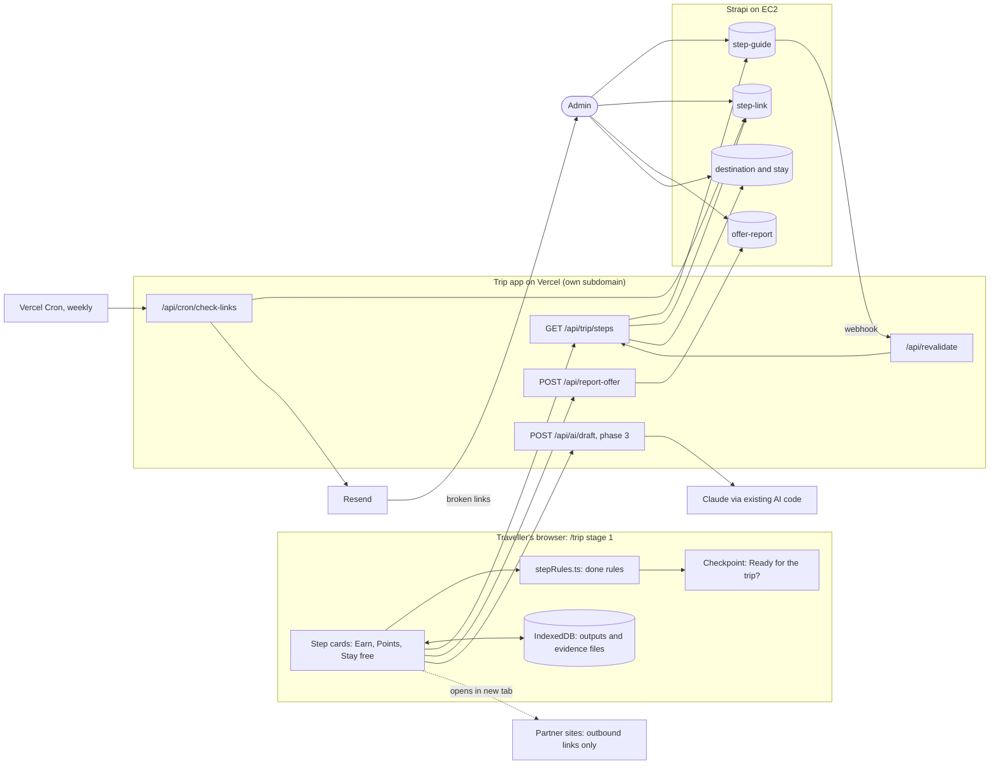
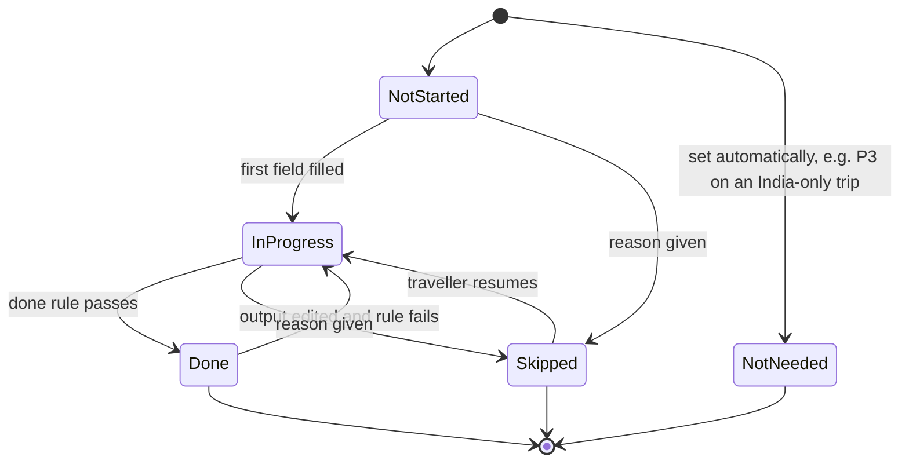
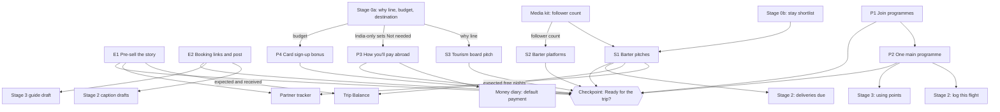
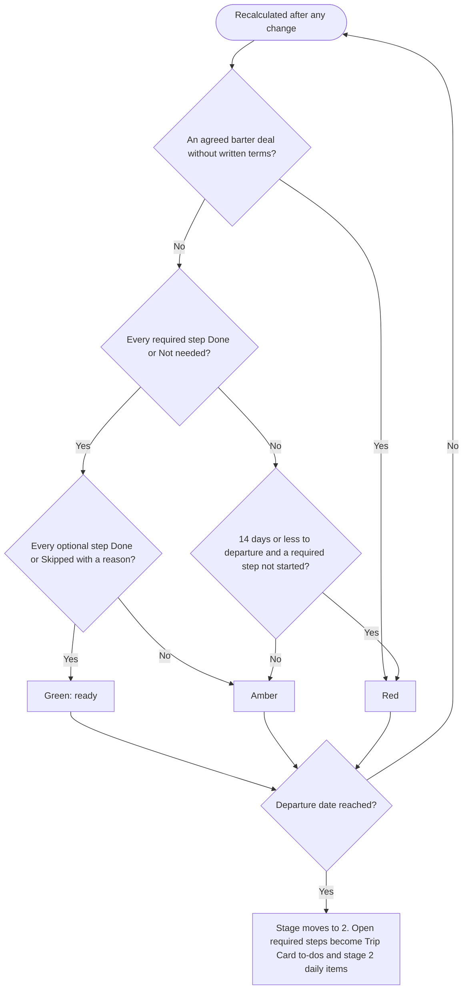
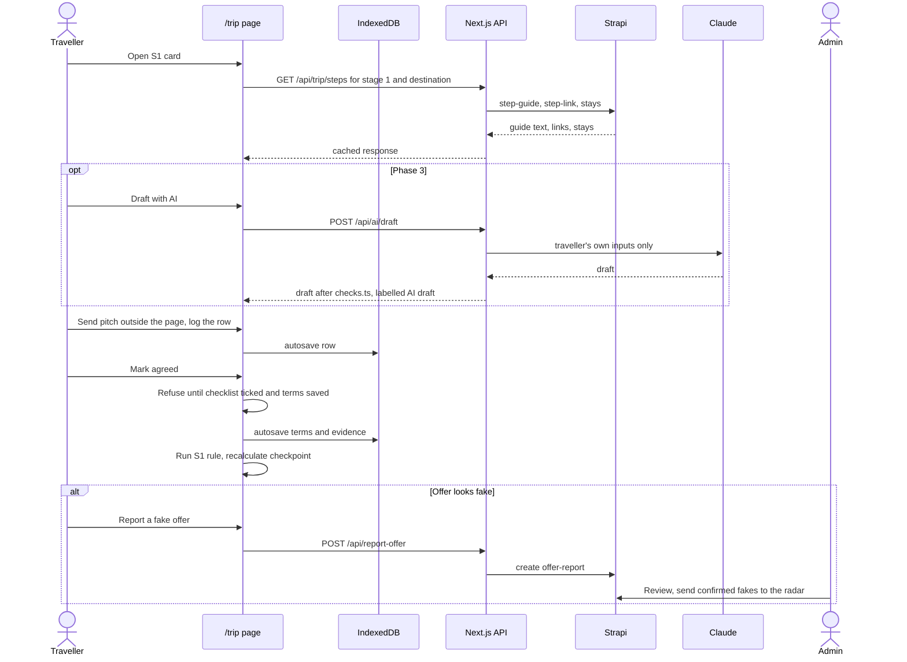
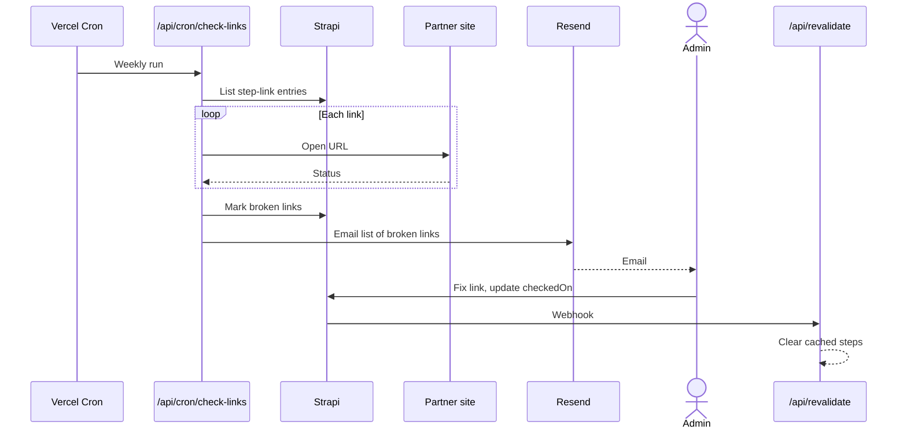

# Trip that pays: plan for a traveller making a documentary

Plan stage. Nothing is built.

Separate plans: [the traveller's page](user-page.md) · [the admin side](admin.md).

---

## 1. What the page is, who it's for and where it lives

**What Pehchan is (proposed line, for you to confirm):** *Pehchan helps Indian travellers, women first, plan safe
trips that pay for themselves, and proves it with its own documentary trips.*

**What the page is:** a public tool where a traveller who is making a documentary plans the whole trip in one place:

- which place, and why
- where to stay
- what to do before, during and after the trip

At every stage it shows how to **earn money, collect points and get free stays**. A running Trip Balance shows
whether the trip is paying for itself.

**Who it's for:**
- Indian travellers, women first.
- Travelling solo first. Travelling with a friend comes later, through a shared trip.
- Going within India or anywhere in the world. **Changed 16 Nov 2026 (owner):** this used to be India plus the five
  corridor destinations you've travelled (Dubai/UAE, Vietnam, Thailand, Malaysia and Nepal). Those stay as
  background, not a limit. A destination goes live only when its pack passes the checks in 1.36. If the rate service
  doesn't cover its currency, that needs a small code change first (1.14).

**Two modes, chosen at the start:**

| Mode | What it shows | Why |
|---|---|---|
| **Creator** | Everything: Do, Earn, Points and Stay free at every stage, pitches, partner tracker, reports | For the traveller making a documentary or content |
| **Just plan it safely** | The planner, safety layer and Pehchan-checked stays. The Earn, Points and Stay free blocks are hidden | Keeps Pehchan's original safety-first travellers and reaches more people with the same page |

**Where it lives (changed 15 Nov 2026):** the trip pages are part of the existing Next.js app, at
`www.pehchanthetraveller.com/trip/` (decision D2 in [tasks/0.01](tasks/0.01-decisions.md)). They are merged in
switched off and turned on at launch (1.40). This replaces the 14 Nov decision for a separate app on its own subdomain; the
points below still describe that earlier setup until the docs are reworked. In this plan, `/trip` means the stage
pages (`/trip/0a` to `/trip/3`).

- **Its own private repo and Vercel project**, on the same stack as the existing Next.js app (Next.js 16, Tailwind 4,
  daisyUI 5), so its code can be copied across.
- **Content from the existing Strapi on EC2,** in new collections, so admin stays in one place. A second Strapi
  webhook points at the trip app's own `/api/revalidate`.
- **Code copied from the existing Next.js app, not shared at runtime:**
  - the trip plan's sharing approach (from `/trip-plan`)
  - Resend email
  - the AI code with `checks.ts`, which blocks invented phone numbers and amounts
  - the evals, and the safety router if it runs on its own (otherwise the trip app links to the existing safety
    pages)
  - the offline page and "Save offline"
  - the Hindi `/hi/` approach (phase 2)
  - Razorpay checkout and the `/trip-plan/premium` pattern (phase 3)
- **Not copied:** the `/stays` directory, because stays in 0b come straight from Strapi. The `/safety` pages are
  linked to, not copied; each stage has its own safety items.
- **This static GitHub Pages repo gets only a nav link** to the trip app, in the desktop nav, the phone drawer and the
  footer. It's public, so no app code, tokens or admin content go here.

The tasks for building it are in [tasks/](tasks/README.md).

**Launch scope:** one destination, picked by AI from anywhere in the world (1.41), plus basics for India. After that,
one new destination is added each month, chosen by what travellers pick in 0a. There's no fixed list. The pace is set
by how fast admin can check facts and stays, never faster. **Changed 16 Nov 2026 (owner):** the target used to be
India plus the five corridor countries, about six months after launch.

---

## 2. Page layout

### The Trip Card (always at the top)

| On the card | Why |
|---|---|
| Destination, dates, the one-line "why" | Keeps the story in focus. The same line is reused in every pitch |
| **Trip Balance:** spent · earned · saved with points · free nights · **net** | The hook. It shows the trip paying for itself as it goes. **The net can be negative, and the page shows that honestly.** It never hides a loss |

**Where each Trip Balance figure comes from.** Every figure is entered by the traveller or comes from their own
outputs. None is estimated by the page or by AI.

| Figure | Comes from |
|---|---|
| **Spent** | The money diary: the ₹ actually paid, from the card or forex statement |
| **Earned** | Money received: E1 pre-sales and sponsors, paid deals in the partner tracker, and booking commission the traveller copies from their own network dashboard. Agreed but unpaid money shows in grey as "expected" |
| **Saved with points** | For each redemption, the traveller enters the points used and the ₹ price they'd otherwise have paid, with a screenshot of that price |
| **Free nights** | Barter nights actually used, from S1 and on-the-spot deals in stage 2. The traveller enters the room's normal price to value them, or leaves it as a count |
| **Net** | Earned + saved with points + value of free nights − spent |
| Current stage and the next step | No one gets lost |
| Mode (Creator / Just plan it safely) | Can be switched at any time |

### The stage stepper (0a → 0b → 1 → 2 → 3)

One stage panel shows at a time, and every stage uses the same four blocks: **Do · Earn · Points · Stay free.** Each
panel also carries that stage's safety items, so safety runs through the page rather than sitting in a separate
corner.

### The honesty strip (always visible)

- **Label every partner post.** Free stays, meals and barter count as a paid relationship under ASCI rules.
- **Free stays can be taxable,** so check with a CA.
- **Get consent** before filming people.

### The honest timeline (shown on the first screen in Creator mode)

| Trip | What usually happens |
|---|---|
| 1 | You pay most of it yourself. Points and a few small barter stays bring the cost down. Commission from booking links is small |
| 2–3 | Some stays are free, a few reels are paid, and the documentary becomes your portfolio |
| After that | Paid partnerships and sponsors. Trips mostly pay for themselves |

*This is a typical pattern, not a sourced figure, and the page labels it that way.*

### Works for everyone, on any device

- **On a phone:** stage 2 is designed for the phone first, with a log that can be filled in one-handed, voice input,
  and offline saving.
- **On a laptop:** stages 0a to 1 get wider comparison tables.
- **Accessibility:** large tap targets, strong colour contrast, every feature usable without a mouse, and a label on
  every input.
- **Language:** English at launch. Hindi in phase 2, using the existing `/hi/` setup.

---

## 3. Stage 0a: Choose the place, and why

**Purpose:** pick the place with a story people will watch and that can earn, not the place picked on a whim.

### What the traveller does

The traveller lists 3 to 5 candidate places and scores each one from 0 to 3 on eight questions. The page fills in
every answer that data can give, and the traveller answers the questions only they can.

| # | Question | Why it matters | How it's answered |
|---|---|---|---|
| 1 | **Is there a story only I can tell?** For example, "first time abroad alone, as an Indian woman, on a set budget" | It separates the film from thousands of "top 10" videos | The traveller. AI can suggest 2–3 angles from their profile |
| 2 | **Do Indians want to go there?** | Reels and similar posts shape where 44% of Indians travel ([Business Standard](https://business-standard.com/finance/personal-finance/movies-reels-celebs-how-44-of-indians-pick-their-travel-destinations-124092400751_1.html)) | Recent video counts and views from the YouTube Data API, plus the traveller's own check on Instagram |
| 3 | **How crowded is it with creators already?** | Too crowded and you get lost; too unknown and nobody searches for it | YouTube Data API counts of recent videos |
| 4 | **Can my audience afford it?** | Viewers who can copy the trip book through your links | Flight prices from Travelpayouts, plus the daily cost range entered by admin |
| 5 | **How easy is the visa?** | Visa trouble wrecks the timeline | **The admin-checked visa note, with a "last checked" date and a link to the official site. AI never states visa rules.** Sources disagree. For example, reports say Thailand moved Indians from visa-free entry to visa on arrival in 2026 while Malaysia opened up ([Pickyourtrail](https://pickyourtrail.com/blog/visa-free-countries-for-indians), [Gulf News](https://gulfnews.com/world/asia/india/visa-free-travel-for-indian-passport-holders-in-2026-complete-list-of-55-destinations-1.500407454)) |
| 6 | **Can it earn?** | It needs bookable stays and tours, homestays that want content, and a tourism board that works with creators | Booking-link coverage, plus an admin note on tourism boards and creator-friendly stays |
| 7 | **Can I film there?** | Drone and filming permits, how safe it is to film alone, light in that season | The admin's permit note, plus the traveller's own comfort |
| 8 | **Is the timing right?** | A festival or season gives the film its story. Publish **before** Indians plan that trip | The admin's festival list and climate months |

There's a bonus point for places the traveller has already been to, because the film is deeper and more believable.

**The score comes from the formula and the data, never from AI.** AI only explains in plain words why the top place
fits this traveller's budget, month and story angle.

### Facts shown for each place, each with its source and date

| Fact | Where it comes from | Why it comes from there |
|---|---|---|
| **Best months (climate)** | Entered once per destination by admin from the national weather service or tourism board, with a link | Open-Meteo's free API is **non-commercial only** ([terms](https://open-meteo.com/en/terms)), and this page earns money. Climate averages barely change, so no live API is needed |
| **Travel advisory** | The UK government's GOV.UK content API (`/api/content/foreign-travel-advice/<country>`) | Free. Its licence requires a credit, so the page says "UK government travel advice". India's foreign ministry has no API |
| **Country basics** (currency, languages) | REST Countries | Free |
| **Exchange rate to INR** | **Frankfurter** for THB, MYR and USD. **Dirham:** its fixed rate to the US dollar (3.6725), combined with USD→INR. **Nepali rupee:** its fixed rate to the Indian rupee (1.6). **Dong:** entered monthly by admin, with a source | Frankfurter's 30 currencies don't include AED, VND or NPR ([list](https://api.frankfurter.dev/v1/currencies)). Admin confirms both fixed rates on the central banks' sites |
| **Festivals** | Entered once a year per destination by admin | Calendarific's free plan is 500 calls a month with a credit required, and paid plans start at $12 a month ([pricing](https://calendarific.com/pricing)). A few destinations are quicker to enter by hand |
| **Visa** | Admin, dated, with an official link | No free official API exists |
| **Daily cost range** | Admin, dated, with sources | Needs judgement |
| **Creator crowding** | YouTube Data API v3, refreshed weekly | Free within a daily quota. YouTube requires most stored API data to be **refreshed or deleted within 30 days** ([policy guide](https://developers.google.com/youtube/terms/developer-policies-guide)), so a weekly refresh fits |
| **Flight prices** | Travelpayouts (Aviasales) Data API | Free with their affiliate programme, and it earns commission. Check their rules on caching and showing prices before building |

### Who does what in 0a

| Already on the page | Traveller enters | Admin looks after |
|---|---|---|
| The destination list with all the facts above, the scoring with data already filled in, example "why" lines | Home city, budget, travel month, passport country, trip length, 3–5 places, story angle, scores for the questions only they can answer, final pick and "why" | Visa notes and costs rechecked monthly with official links. Approve new destinations before they appear. Fix data that looks wrong. Review the scoring weights every quarter |

### Safety in 0a

- The advisory sits beside every place.
- Question 7 includes "how safe is it to film alone here".
- A place with a serious advisory is flagged on its card rather than hidden. The traveller decides with the facts in
  front of them.

### Done when, and what carries forward

**Done when:** one place is picked and the "why" line is written.

**Carries forward:** the "why" line goes into the media kit and every pitch in stage 1. The place and dates go into
stage 0b.

---

## 4. Stage 0b: Choose the stays

**Purpose:** where you stay is part of the film and the biggest cost, so choose it for the story as well as for
sleep.

### The stay mix

| Type | When | What it gives you |
|---|---|---|
| **Homestay or guesthouse (your base)** | Most nights | Characters for the story (the host family and their food), low cost, and the **best chance of a free stay** in exchange for content |
| **Hostel** | 1–2 nights | Other travellers to film and talk to, the cheapest beds, the solo-travel angle |
| **One hero stay** | 1 night | One beautiful place for the film's big moment, pitched as "featured in the documentary" |
| **Chain hotel** | Nights no partner covers | **Paid with points**, which keeps the trip affordable |

### The 6-point check for every stay

1. **Safe:** a well-lit area that's busy in the evening, with recent reviews from women travelling alone.
2. **Close to your shots:** within walking distance of sunrise and sunset spots.
3. **Real:** recent guest photos match the listing photos, and the exact location checks out on a map.
4. **Practical:** fast WiFi for uploads, power backup for charging gear, a locker for the camera, laundry.
5. **Flexible:** free cancellation, because filming plans change.
6. **Earns:** bookable through a booking link that pays commission.

**Choose the neighbourhood first, then the property.** Pick an area with character, such as an old town, a market
street or a waterfront. It becomes a scene you can film every day for free.

### Two badges that never mix

| Badge | Meaning | Rule |
|---|---|---|
| **Pehchan-checked** | Admin has verified the stay: safety notes, WiFi, power, real photos | **Never paid for.** If verification could be bought, the brand would lose its point |
| **Open to creator stays** | The stay has agreed in writing to consider content-for-stay deals | Commercial. Free for the first hotels, and may become paid later (section 11). Always labelled |

### Data for 0b

| Need | Source | Note |
|---|---|---|
| Stays | Pehchan-checked stays from Strapi, plus Agoda booking links (Agoda pays about 4–7%, [track360](https://track360.io/blog/agoda-affiliate-program-operator-teardown-2026)) | Booking.com's Demand API needs approval, so it comes later. Check each programme's rules on showing prices |
| Location | **Admin looks up each stay's map position once** and saves it in Strapi. The page links out to a map app | Nominatim (OpenStreetMap's lookup service) allows at most **1 request per second**, requires caching, and bans search-as-you-type ([policy](https://operations.osmfoundation.org/policies/nominatim/)). No embedded map at launch. OpenStreetMap's tile servers have their own rules, so check them before embedding one |
| Review summary | Reviews the traveller pastes in, or that we're allowed to use | AI writes "what women travelling alone say about this area", labelled "AI summary of reviews" |

### Who does what in 0b

| Already on the page | Traveller enters | Admin looks after |
|---|---|---|
| Checked stays per destination (area, women-safety notes, WiFi and power, badges), the 6-point checklist, booking links | Dates, budget per night, stay style, shortlist, checklist answers, any stay not on our list | Verify stays and add notes. Give the creator badge only with the stay's written OK. Keep booking links working and labelled. Review stays travellers suggest |

### Earn, points, stay free and safety in 0b

- **Earn:** every stay booked through the page's links earns commission for Pehchan. In Creator mode, the traveller
  can use their own booking links in their content.
- **Points:** chain-hotel nights are planned as points nights.
- **Stay free:** stays with the "open to creator stays" badge are listed first for barter pitches.
- **Safety:**
  - First barter stays only at places with recent reviews from women travelling alone.
  - Meet hosts in a public place first.
  - Check that the listing matches the exact map location.

**AI flags** any shortlisted stay that fails the 6-point check, for example one far from the sunrise spots.

### Done when, and what carries forward

**Done when:** the base and hero stays are chosen and pass the 6-point check.

**Carries forward:** the stays go into the partner tracker (stage 1) and the booking links.

---

## 5. Stage 1: Before (4–8 weeks out)

### Do

| What | Why |
|---|---|
| Plan the story and shot list: day-by-day scenes, people to meet, places that need permission | Usable footage, not random clips |
| Check filming and drone rules for each country | Many countries need drone permits, and some need filming permits |
| Make a 1-page media kit: who you are, the story, your channels and numbers, past work | Needed for every pitch |
| Pitch hotels, homestays, tour operators and the tourism board | How free stays and paid deals start |
| Sort the paperwork: consent forms, travel insurance that **covers camera gear**, a music licence | Without these the film can't be sold, and gear loss can end the trip |
| Post "I'm going to X, what should I film?" | Builds an audience before the trip |

### Earn, Points and Stay free: guided steps (Creator mode)

Every money item in stage 1 is a **step card**, not a bullet. Each card has five parts:

| Part | What it holds |
|---|---|
| **How to do it** | Suggestions written by admin and kept in Strapi with a checked date |
| **Do it here** | Links, kept by admin in Strapi, each with a checked date. Affiliate and network links are labelled as such |
| **Your output** | The fields the traveller fills in. Saved automatically as they type |
| **Counts as done when** | The rule the page checks before marking the step done |
| **Feeds** | Where the output goes next, so nothing is typed twice |

Each step has a status: **Not started · In progress · Done · Skipped** (a reason is required) **· Not needed**
(set automatically, for example a forex card on an India-only trip).

**Required in Creator mode:** E2, P1, P2, P3 (international trips only) and S1. **Optional:** E1, P4, S2 and S3.

#### E1 · Pre-sell the story (optional on the first trip)

**How to do it**
- Choose **one** route for the first trip, not all three.
- **Sponsor slot:** pitch brands you already use on this trip, such as luggage, camera gear, eSIM, insurance or
  forex. Offer something specific, like a named mention in the film plus one reel. No sourced market price exists
  for a documentary sponsor slot, so price it from the quotes you get and record them.
- **Paid "follow my trip" group:**
  - **Instagram Subscriptions.** Check the Professional Dashboard for "Set up subscriptions". Sources disagree on
    whether it's reliably available to Indian creators.
  - **A paid Telegram group** through an Indian creator platform such as Cosmofeed. It has mixed user reviews, so
    start small.
  - **A one-off "trip pass"** on your own Razorpay Payment Page. You don't need a website.
- **Crowdfund:** Kickstarter's official list of countries where you can create a project doesn't show India, so
  don't plan on it until you've checked the live list.
- **Pehchan never collects this money.** The traveller uses their own account.

**Do it here**
- [Razorpay Payment Pages](https://razorpay.com/payment-pages)
- [Cosmofeed](https://cosmofeed.com)
- [Kickstarter: who can use it](https://help.kickstarter.com/en-us/articles/16236650-who-can-use-kickstarter)
- Instagram Subscriptions: in the app, under Professional Dashboard
- The media kit builder in this stage

**Your output:** route · offer text · price (₹) · link to the offer page · sponsors pitched (name, date, reply) ·
amount agreed · amount received

**Counts as done when:** a route is chosen, the offer link is saved, and at least one pitch or launch has a date.
Otherwise it's skipped with a reason.

**Feeds:**
- The Trip Balance. An agreed amount shows in grey as "expected". Only money actually received counts in the net.
- The partner tracker, for sponsor deliverables.

#### E2 · Booking links and a "how I planned this" post (required)

**How to do it**
- Join one network that covers several brands, such as Travelpayouts, rather than many separate programmes.
- Apply early, because approval can take a few days.
- Make links only for things you actually booked or used.
- Label the post as containing affiliate links, and post it **before** you leave.

**Do it here**
- [Travelpayouts](https://www.travelpayouts.com/), which also offers [GetYourGuide](https://travelpayouts.com/en/offers/getyourguide-affiliate-program)
- [GetYourGuide direct](https://partner.getyourguide.com/)
- [Klook direct](https://affiliate.klook.com/), or [Klook via Involve Asia](https://involve.asia/blog/klook-affiliate-program/)

**What it pays.** The page shows each range with its source:
- GetYourGuide: about 8%, from the Travelpayouts listing. No official GetYourGuide page was found confirming it.
- Klook: figures differ by source. Involve Asia says 5–6.5%; a review of Klook's own affiliate page says up to 5%.

**Your output:**
- programmes (name, date applied, status: pending or approved)
- this trip's tracking links (what it's for, the link)
- the post's URL, or its scheduled date
- a tick confirming the post is labelled

**Counts as done when:** at least one programme is approved, at least one tracking link is saved (an `https` link
on that programme's domain), the post URL or a scheduled date before departure is saved, and the label is ticked.

**Feeds:** the stage 2 caption drafts, the stage 3 guide draft, and the `affiliate_click` metric.

#### E3 · Insurance, eSIM and forex commission

Not shown until their commission rates are researched and sourced. Not part of the checkpoint.

#### P1 · Join loyalty programmes before booking (required)

**How to do it**
- Join **before** you book anything. Check each programme's rule for claiming points after the fact; don't assume
  you can.
- Pick the airline that flies your route, using the flight search from stage 0a.
- Pick a hotel chain that has properties at your destination.
- Use your name exactly as it appears on your passport.

**Do it here**
- [Air India Maharaja Club](https://www.airindia.com/in/en/maharaja-club/about.html). One source says there are 1,000
  bonus points after the first flight; check the official terms.
- [IndiGo BluChip](https://www.goindigo.in/loyalty.html)
- The destination's airlines and hotel chains: admin adds the official sign-up link for each destination, after
  checking it.

**Your output:**
- programme name
- airline or hotel
- date joined
- optional: the last 4 digits of the membership number
- date of the first booking

**Counts as done when:** at least one airline and one hotel programme are joined, and each was joined on or before
the first booking. If a booking came first, the page warns: "Booked before joining. Check whether you can claim
these points."

#### P2 · Pick one main programme of each kind (required)

**How to do it**
- Pick your main airline from the one you fly most on your home routes.
- Pick your main hotel chain from the one present across the places you travel to most.
- Note how long points last. For example, a third-party guide says IndiGo BluChips last 24 months and are extended
  by any activity; check the official terms.

**Your output:** main airline · main hotel chain · why · rule on how long points last, with a source link

**Counts as done when:** both are chosen and each expiry rule has a source.

**Feeds:** the stage 2 reminder to log every flight, and the stage 3 redemption tips.

#### P3 · How you'll pay abroad (required for international trips, not needed for India)

**How to do it**
- Compare options on the issuer's own page:
  - the forex markup %
  - the ATM withdrawal fee
  - the load or reload fee
  - what happens to any leftover balance
- Carry two ways to pay.
- Pehchan doesn't recommend a specific card.

**Do it here:** your own bank's or forex card provider's page. No fixed link.

**Your output:** the payment method(s) · markup % · ATM fee · source link. **Never card numbers.**

**Counts as done when:** at least one method is saved with its markup % and a source link.

**Feeds:** the default payment method in the money diary.

#### P4 · Travel card sign-up bonus (optional)

**How to do it**
- Only consider a card if you'll reach the bonus with spending you'd make anyway.
- Count the annual fee.
- Pehchan doesn't recommend a card.

**Your output:** card name · bonus terms · spend needed · deadline · annual fee · source link

The page compares the spend needed with the trip budget entered in stage 0a and shows **"reachable"** or
**"not reachable"**.

**Counts as done when:** the traveller has decided (applying or not) and saved the source link, or skipped the step.

#### S1 · Barter pitches (required)

**How to do it**
- Pitch stays with the "open to creator stays" badge from stage 0b first. Then try small, new homestays, which say
  yes most often.
- Offer specific deliverables and dates, for example "3 reels plus a section in the documentary in exchange for
  2 nights".
- Attach your media kit and one sample reel.
- Follow up once.
- Get the terms in writing, by email or WhatsApp:
  - nights and dates
  - room type
  - meals
  - deliverables and deadlines
  - the ad label you'll use
- Run the fake-offer checklist before accepting anything.

**Do it here**
- the 0b shortlist in the trip app
- each stay's own website or Instagram, from its Strapi record
- the pitch template, with an optional AI draft labelled "AI draft, edit before sending"
- the media kit

**Your output, one row per pitch:**
- stay
- channel
- date sent
- offer
- date followed up
- reply: no reply, declined, counter-offer or agreed
- the written terms, as a screenshot, file or pasted text
- a tick confirming the fake-offer checklist passed

**Counts as done when:** at least 5 pitches are sent (a target the traveller can change), and every agreed deal has
written terms saved and has passed the fake-offer checklist. **No agreements is still done.** That's an honest result
on a first trip.

**Feeds:**
- the partner tracker (pitched → agreed → delivered → reported)
- the Trip Balance: agreed free nights show as "expected", and count once they're used
- stage 2's "deliveries due today"

#### S2 · Barter platforms: check eligibility first (optional)

**How to do it:** check the rules before signing up. The page compares each platform's minimum with the follower
number in the media kit and shows "eligible" or "not yet eligible", so the traveller doesn't waste time.

**Do it here**
- [Barter](https://getbarter.com/faq-creators/). Its own pages disagree, saying 2,000 or 2,500 Instagram or TikTok
  followers.
- TripGyani: a one-year-old account and 5k+ followers, from earlier research. This wasn't confirmed again in the
  14 Nov check, so admin rechecks it before the page shows it.
- [Travelpayouts creator collaborations](https://social.travelpayouts.com/creators-and-influencers): Instagram only for
  now, with no minimum stated.

**Your output:** platform · eligible (checked automatically) · date applied · status

**Counts as done when:** eligibility is checked, or the step is skipped.

#### S3 · Tourism board pitch (optional)

**How to do it**
- Pitch the story angle from stage 0a: what the Indian audience will see, your dates, and your deliverables.
- Ask for introductions to local partners, not only a fully hosted trip.
- Write to the media or PR contact, not the general enquiries address.

**Do it here:** admin stores each destination's checked media or PR contact. For Thailand, for example, the tourism
board launched its [TAT Connex influencer platform](https://tatnews.org/2024/08/tat-connex-influencer-marketing-platform-officially-launched)
in August 2024. How to sign up isn't confirmed. Its March 2026 familiarisation trip, which included creators from
India, appears to have been [by invitation](https://www.tatnews.org/2026/03/tat-hosts-amazing-thailand-smile-south-mega-fam-trip-to-spotlight-southern-thailand-recovery/).

**Your output:** tourism board · contact used · date sent · story line · reply · outcome

**Counts as done when:** the pitch is sent, or the step is skipped with a reason.

### How step outputs are saved

- **Saved on every change.** There's no save button.
- **Where they're kept:**
  - Phases 1–2: in the traveller's browser, using the browser's file-capable storage so screenshots fit.
  - Phase 3: in the traveller's account.
- **Export my trip** includes every output and file.
- Every output records when it was entered. Evidence files stay on the traveller's device.
- **Never stored:**
  - card numbers
  - full membership numbers
  - passport details
  - passwords for any programme

### Stage 1 checkpoint: "Ready for the trip?"

One screen lists everything in stage 1:
- the Do items: shot list, permits, media kit, consent form, insurance
- the safety items
- the guided steps above

Each row shows its status, what's missing, and a **"Go to step"** link.

| Checkpoint | When |
|---|---|
| **Green: ready** | Every required step is done, and every optional step is done or skipped with a reason |
| **Amber** | Anything that isn't green or red, for example a required step still in progress, or an optional step neither done nor skipped |
| **Red** | Departure is 14 days away or less and a required step isn't started, or an agreed barter deal has no written terms |

The checkpoint never blocks the traveller. On the departure date the stage moves on anyway:
- Required steps still open become to-dos on the Trip Card.
- They also show in the stage 2 daily view, for example "Terms for Stay X still not in writing".
- The checkpoint updates whenever the traveller finishes a step, even after leaving.

In **Just plan it safely** mode, the checkpoint covers only the Do and safety items, because the Earn, Points and
Stay free blocks are hidden.

AI drafts pitches only. It never fills in an output, an amount or a status.

### What each stage 1 step needs to build

For every one of these steps, the partner sites are **outbound links**. The traveller signs up and makes links on each
site. Pehchan doesn't call partner APIs here and can't check, for example, whether an affiliate application was
approved; the traveller reports it. Partner APIs such as Travelpayouts and YouTube are used in stage 0a, not here.

#### Built once, shared by every step

| Layer | What |
|---|---|
| **User page** | The `/trip` stage 1 panel. Step cards are grouped under Earn, Points and Stay free, and each has a status chip and a "Skip" button that asks for a reason. The cards are hidden in "Just plan it safely" mode |
| **Frontend** | `StepCard`: the guide text, links, output form and status.<br>`OutputForm`: built from each step's list of fields.<br>`EvidenceUpload`: screenshots and files.<br>`LinkList`: labels affiliate links and shows when each link was last checked.<br>`stepRules.ts`: one function per step that decides whether the step is done. It's plain code, so phase 3 can run the same rules on the server.<br>An autosave hook |
| **Backend** | `GET /api/trip/steps?stage=1&destination=<slug>` reads step-guide and step-link from Strapi and caches the result. When admin edits them, a Strapi webhook calls `/api/revalidate` to clear the cache |
| **Admin page** | Strapi `step-guide` and `step-link` |
| **Data** | Phases 1–2: IndexedDB in the browser, one record per trip. Phase 3: the account database |
| **APIs** | Strapi REST only |
| **Events** | `step_completed`, `step_skipped` |

#### E1 · Pre-sell the story

| Layer | What |
|---|---|
| **User page** | A choice of route (sponsor, paid group or crowdfund), then fields for the offer text, price in ₹ and offer link, a row per sponsor pitched, and the amounts agreed and received. Shows the notes on Kickstarter and on whether Instagram Subscriptions is available |
| **Frontend** | Checks the offer link is https. The Trip Balance shows an agreed amount in grey as "expected" and counts only money received in the net. From phase 2, each sponsor row also creates a partner-tracker entry |
| **Backend** | Nothing beyond the shared parts. Pehchan stores no payment data |
| **Admin page** | E1 guide text. Links to Razorpay Payment Pages, Cosmofeed and Kickstarter's eligibility page, with a note on the conflicting Instagram sources |
| **APIs** | None. The traveller uses their own Razorpay, Cosmofeed or Instagram account. Pehchan's own Razorpay account isn't involved |
| **Done rule** | A route, an offer link and at least one dated pitch or launch. Otherwise skipped with a reason |
| **Feeds** | "Earned" in the Trip Balance, and the partner tracker |
| **AI** | A draft sponsor pitch (phase 3) |
| **Phase** | 1: the form. 2: the tracker link. 3: AI |

#### E2 · Booking links and the "how I planned this" post

| Layer | What |
|---|---|
| **User page** | A row per programme (name, date applied, pending or approved), a row per tracking link (what it's for, the URL), the post URL or its scheduled date, and a tick confirming the post is labelled. Commission rates are shown with their sources |
| **Frontend** | Checks each tracking link is https and on one of that programme's allowed domains. Approval is whatever the traveller reports |
| **Backend** | Nothing beyond the shared parts |
| **Admin page** | Links to Travelpayouts, GetYourGuide, Klook and Involve Asia, each with its allowed domains and a commission note with its source |
| **APIs** | None. The traveller makes links on each network's own site |
| **Done rule** | At least one approved programme, at least one valid link, the post URL (or a date before departure), and the label ticked |
| **Feeds** | Caption drafts in stage 2, the guide draft in stage 3, and `affiliate_click` |
| **Phase** | 1 |

#### E3 · Insurance, eSIM and forex commission

| Layer | What |
|---|---|
| **All layers** | Nothing is built until the commission rates are sourced. Admin then adds a step-guide entry and its links, and the shared parts show it without new code |

#### P1 · Join loyalty programmes before booking

| Layer | What |
|---|---|
| **User page** | A row per programme: name, airline or hotel, date joined, an optional field for the last 4 digits of the membership number, and the date of the first booking. Shows a warning if the booking came before joining |
| **Frontend** | Compares the dates. The membership field accepts 4 digits only; there's no field for the full number |
| **Backend** | Nothing beyond the shared parts |
| **Admin page** | Links for each destination: Air India Maharaja Club, IndiGo BluChip, and each destination's airlines and hotel chains once checked. Notes on sign-up bonuses, with sources |
| **APIs** | None. Outbound sign-up links only; no loyalty programme API |
| **Done rule** | At least one airline programme and one hotel programme, each joined on or before the first booking |
| **Feeds** | The choices in P2 |
| **Phase** | 1 |

#### P2 · One main programme of each kind

| Layer | What |
|---|---|
| **User page** | Main airline and main hotel chain, a "why" field, and the rule on how long points last, with a source link |
| **Frontend** | The airline and hotel lists come from the P1 rows. A source link is required |
| **Backend** | Nothing beyond the shared parts |
| **Admin page** | Guide text with an example rule on how long points last, with its source |
| **APIs** | None |
| **Done rule** | Both are chosen, each with a sourced rule on how long points last |
| **Feeds** | The "log this flight" reminder in stage 2 and the tips on using points in stage 3 |
| **Phase** | 1 |

#### P3 · How you'll pay abroad

| Layer | What |
|---|---|
| **User page** | A row per payment method: name, markup %, ATM fee, reload fee, what happens to leftover money, and a source link. Shows "Not needed" on India-only trips |
| **Frontend** | Sets the step to "Not needed" automatically when the destination from 0a is in India. Checks the percentages are numbers. There's no field for a card number |
| **Backend** | Nothing beyond the shared parts |
| **Admin page** | Guide text only. There are no links, because Pehchan doesn't recommend a card |
| **APIs** | None |
| **Done rule** | At least one method with its markup % and a source link |
| **Feeds** | The default payment method in the money diary |
| **Phase** | 1 |

#### P4 · Travel card sign-up bonus

| Layer | What |
|---|---|
| **User page** | Card name, bonus terms, spend needed, deadline, annual fee and a source link. Shows "reachable" or "not reachable" |
| **Frontend** | Compares the spend needed with the trip budget from 0a |
| **Backend** | Nothing beyond the shared parts |
| **Admin page** | Guide text only |
| **APIs** | None |
| **Done rule** | A decision and a source link, or skipped |
| **Phase** | 1 |

#### S1 · Barter pitches

| Layer | What |
|---|---|
| **User page** | A row per pitch, a place to upload or paste the written terms, the fake-offer checklist, a "Report a fake offer" button and a pitch target the traveller can change. From phase 3, a "Draft with AI" button |
| **Frontend** | The stay picker lists the shortlist from 0b with "open to creator stays" stays first. A pitch can't be marked "agreed" until every checklist item is ticked. Evidence files stay on the device |
| **Backend** | `POST /api/report-offer` saves a report to the Strapi `offer-report` collection.<br>Phase 3: `POST /api/ai/draft` using the existing AI code, the `AI_ENABLED` flag, `checks.ts` and `evals/pitch.jsonl`.<br>Phase 2: delivery reminders through Resend, only to travellers who give their email and opt in. Everyone else sees reminders on the page |
| **Admin page** | Guide text and the default pitch target (5). Each stay's website, Instagram and creator badge. A review queue for `offer-report`, from which confirmed fakes go to the radar |
| **APIs** | Strapi. Resend (phase 2). Claude (phase 3) |
| **Done rule** | At least the target number of pitches sent, and every agreed deal has written terms and a passed checklist |
| **Feeds** | The partner tracker, expected free nights in the Trip Balance, and deliveries due in stage 2 |
| **Phase** | 1: the form and checklist. 2: the tracker and reminders. 3: AI |

#### S2 · Barter platforms: check eligibility first

| Layer | What |
|---|---|
| **User page** | A row per platform showing "eligible" or "not yet eligible", the date applied and the status |
| **Frontend** | Compares the follower number in the media kit with each platform's minimum |
| **Backend** | Nothing beyond the shared parts |
| **Admin page** | Links with each platform's minimum follower count and a note. Barter's own pages disagree (2,000 or 2,500). TripGyani stays hidden until admin rechecks it |
| **APIs** | None |
| **Done rule** | Eligibility checked, or skipped |
| **Phase** | 1 |

#### S3 · Tourism board pitch

| Layer | What |
|---|---|
| **User page** | The destination's tourism board contact and a row per pitch |
| **Frontend** | Fills in the story line from the "why" written in 0a |
| **Backend** | Nothing beyond the shared parts. Phase 3 adds an AI draft through `/api/ai/draft` |
| **Admin page** | A `tourismBoardMediaContact` field and a `checkedOn` date on each destination. For example, the TAT Connex note for Thailand |
| **APIs** | None. Claude for the draft (phase 3) |
| **Done rule** | Sent, or skipped with a reason |
| **Phase** | 1, and 3 for AI |

#### Saving the outputs

| Layer | What |
|---|---|
| **User page** | No save button. "Export my trip" gives a file and a PDF, and "Import" brings a trip back |
| **Frontend** | Saves to IndexedDB after each change, holding evidence files as well as text. Warns before browser data is cleared |
| **Backend** | None in phases 1–2. Phase 3 adds the account database, with sign-in by an email link sent through Resend |
| **Never stored** | Card numbers, full membership numbers, passport details and programme passwords |

#### Stage 1 checkpoint: "Ready for the trip?"

| Layer | What |
|---|---|
| **User page** | One screen with a row per item: its status, what's missing and a "Go to step" link. The screen shows green, amber or red overall |
| **Frontend** | Works out the colour from the step rules, the Do and safety items, and the departure date. On the departure date, open required steps become to-dos on the Trip Card and in the stage 2 daily view |
| **Backend** | None in phases 1–2. In phase 3 the same rules run on the server, so emailed reminders can use them |
| **Admin page** | Which steps are required or optional, and the 14-day threshold, both editable in `step-guide` |
| **Events** | `checkpoint_status` on the departure date |

#### Admin page and background jobs

| Item | What |
|---|---|
| **`step-guide`** | Step ID, guide text, required or optional, and the numbers the rules use (pitch target 5, threshold 14 days) |
| **`step-link`** | Step ID, label, URL, destination, kind, allowed domains, minimum followers, commission note with its source, and `checkedOn` |
| **`offer-report`** | Reported fake offers waiting for review |
| **`destination`** | Plus `tourismBoardMediaContact` |
| **Weekly link check** | A Vercel Cron job calls `/api/cron/check-links`, which opens every outbound link (step links, stay booking links, official visa, permit and emergency links), marks broken ones in Strapi and emails admin through Resend |
| **Most-skipped steps** | Counted from `step_skipped` events in the analytics tool, which hasn't been chosen yet |

#### Services used across stage 1

| Service | Used for | Phase |
|---|---|---|
| Strapi REST | Guide text, links, stays, destinations, fake-offer reports | 1 |
| `/api/revalidate` | Clearing cached guide text and links when admin edits them | 1 |
| Vercel Cron | The weekly link check | 1 |
| Resend | Broken-link emails to admin (1). Opt-in reminders to travellers (2). Sign-in links (3) | 1–3 |
| Claude, through the existing AI code | Drafting pitches | 3 |
| Partner sites (Razorpay, Cosmofeed, Travelpayouts, GetYourGuide, Klook, airlines, barter platforms, tourism boards) | Outbound links only | 1 |

### Stage 1 diagrams

**How the parts connect**



**Status of each step**



**What each step uses and feeds**



**How the checkpoint picks its colour**



**S1, one barter pitch from start to finish**



**Weekly link check**



### Safety in stage 1

| Item | What the page does |
|---|---|
| **Fake collaboration offers** (a fake hotel, a "registration fee", requests for passport scans) | A checklist: verify through the hotel's official website and phone number, **never pay to collaborate**, and share ID only at check-in, as the law requires. A "report a fake offer" button sends it to admin, and from there to the radar |
| **Someone knows your plan** | Share the itinerary with one trusted contact, using the existing trip-plan share |
| **Insurance** | A reminder to buy cover that includes camera gear |
| **Emergency card** | Prepared now and saved for offline use in stage 2 |

### Who does what in stage 1

| Already on the page | Traveller enters | Admin looks after |
|---|---|---|
| Templates: shot list, media kit, hotel pitch, tourism-board pitch, consent form (English and Hindi), points plan. Permit and drone notes per country. Ad-label and tax reminders. Optional AI drafts | Channels and follower numbers, sample work, shot list, partners pitched, deal terms (barter or paid, what to deliver, deadline), programmes joined. **Never card numbers** | Keep templates current. Have the consent form checked by a lawyer once. Keep permit notes dated. Spot-check AI drafts |

### The partner tracker
Each partner moves through **pitched → agreed → delivered → reported**. It records:
- the deal type (barter or paid)
- what's owed and by when
- the ad label to use

Delivery reminders go out by email through Resend.

### Data in stage 1

| Need | Source | Note |
|---|---|---|
| Audience numbers for the media kit | Phases 1–2: the traveller types their numbers and uploads a screenshot. Phase 3: connected YouTube Analytics and Instagram | The Instagram API needs a professional (business or creator) account and **Meta app review**. YouTube data follows the 30-day refresh rule |
| Tours | GetYourGuide Partner API, Klook, Viator Partner API | All pay commission |
| Pre-sell payments | Razorpay | Phase 3, and **only for Pehchan's own documentary** (section 11) |
| Reminders | Resend | Already in the app |
| Alerts (strikes, visa changes) | The radar, published only after a person checks each one | — |

### AI in stage 1
AI drafts the shot list from the story angle, the media kit text, and hotel and tourism-board pitches, in Hindi or
English.

- **Numbers come only from the traveller or connected accounts, never from AI.**
- Every draft is labelled "AI draft, edit before sending".
- AI never sends anything; the traveller presses send.
- AI can also explain which loyalty programme to focus on, using only the traveller's own inputs.

### Done when, and what carries forward

**Done when:** the "Ready for the trip?" checkpoint is green. The stage moves on automatically on the departure date
even if it isn't; open items show as to-dos.

**Carries forward:** partners and deliveries due go into the stage 2 daily view.

---

## 6. Stage 2: During the trip

### Do

| What | Why |
|---|---|
| Film the story every day: an opening, problems, people, a turning point. Also B-roll: wide shots, close-ups, sound | A documentary needs a story to edit |
| Get a signed consent form from everyone you feature | Without it the film can't be sold |
| Post short clips daily: reels, Shorts and Stories | The audience grows while you travel |
| Keep the money diary | It becomes content ("Vietnam in ₹40k") and feeds the Trip Balance |
| Deliver exactly what you promised each partner, on time and labelled | Repeat free stays come from reputation |
| Collect contacts: guides, cafés, other creators | Partners for the next trip |

### Earn
- **Paid reels** for hotels, cafés and tour operators you're already using. Indian micro-creators earn about
  ₹8k–20k a reel under 30k followers, and ₹20k–50k at 30k–100k
  ([Entstargate](https://www.entstargate.com/influencer-rate-card/)).
- **Booking links** for every tour, stay and SIM card you use.
- **Stock footage,** but only clips without identifiable people, or with signed releases.

### Points
- Put every payment on the card.
- Book direct when the hotel programme gives more than the booking site's discount.
- Log every flight to your airline account.
- Use rewards shopping portals.

### Stay free
- **Content-for-stay deals on the spot** with homestays and hostels, showing yesterday's reel as proof.
- **House-sitting and work-exchange sites** (TrustedHousesitters, Worldpackers, Workaway) charge a yearly membership.
- **Working for a stay on a tourist visa can break visa rules** in some countries, so check before you go.

### Safety in stage 2

| Item | What the page does |
|---|---|
| **"Post after you've left" rule** | No location tags or Stories from where you're staying until you've checked out. A reminder sits beside every post in the daily log |
| **Daily check-in** | A nudge to message the trusted contact |
| **Safety card** | Works offline: checked emergency numbers with source and date. **Never AI-generated** |
| **Emergency questions** | Answered by the app's existing safety router, which sends emergencies to official help |
| **Checked alerts** | Strikes and visa changes from the radar, shown only after a person has checked them |

### The daily log
For each day the log records:
- footage done
- posts made, with a ticked ad label for partner posts
- money spent: **the local amount plus the INR actually paid**, taken from the card or forex statement, by category
- deliveries done

The real rupees paid matter more than a reference exchange rate, and they make better content.

**Voice input** uses the browser's built-in speech recognition, which is free. Not every browser supports it, so
typing always works too.

### Who does what in stage 2

| Already on the page | Traveller enters | Admin looks after |
|---|---|---|
| Empty log slots, partner deliveries due today, booking links, a quick consent form on the phone, the safety card | The daily log, signed consents (kept **on the traveller's device only**) | Checked alerts. Help numbers checked, with source and date |

### AI in stage 2
- **Voice to log:** "spent 400 baht on dinner, filmed the night market" becomes log entries.
- **Daily caption drafts** from the day's log. The ad label is added automatically when the post is for a partner.
- **Delivery reminders,** for example "Hotel X reel due tomorrow".

### Works on a phone with bad network
Stage 2 saves on the device first and syncs later. Data loads only for this stage, and AI runs only when tapped.

### Moves on
Automatically on the return date.

---

## 7. Stage 3: After the trip

### Do

| What | Why |
|---|---|
| Edit the long version for YouTube or festivals, plus 10–20 short clips | One trip becomes months of content |
| Send each partner a report: views, reach, clicks, screenshots | It turns a one-off barter into a paid repeat deal |
| Write the "how to do this trip" guide: costs, stays, mistakes | It earns booking commission for years |
| Update the media kit with new numbers | The next pitch is easier |
| Submit to festivals or pitch to platforms | Credibility and possible licensing |
| Sort taxes and records | Barter can be income (section 12) |

### Earn
- **YouTube ads** once you qualify for the Partner Programme. One route is 1,000 subscribers and 4,000 watch hours
  in 12 months ([YouTube](https://support.google.com/youtube/answer/72851)).
- **Paid repeat deals** with partners who've seen your results.
- **Digital products:** a paid itinerary, a preset pack, a "plan your own trip" guide.
- **Licensing** the documentary to platforms, airlines or tourism boards.
- **Workshops and talks.**

### Points and stay free
- **Points:** redeem them for the next trip's flight, usually the best value. Hotel points cover nights no partner
  gives free.
- **Stay free:** a finished film and real numbers let you pitch bigger hotels, moving from "please host me" to "here's
  what I deliver".

### Who does what in stage 3

| Already on the page | Traveller enters | Admin looks after |
|---|---|---|
| Partner report template filled in from their numbers, guide page template, edit plan, redemption tips, the Trip Card's final balance | Final numbers (or connected accounts), film link, what each partner got, feedback on stays and partners | **Showcase review:** if the traveller chooses "feature my trip", admin checks it's honest, ads are labelled and consent is shown before publishing. **Disputes:** a stay that broke a deal, or a traveller who didn't deliver, is reviewed, and the creator badge removed if needed |

### AI in stage 3
- **Partner reports** from real numbers only.
- **An edit plan** for the long film and shorts, built from the log.
- **A guide page draft** from the money diary and stays.

All are labelled as drafts.

### Closing the trip
The Trip Balance closes with the real net figure. **"Next place"** returns to 0a, carrying this trip's numbers into
the next media kit and pitches.

---

## 8. Moving between stages

```
0a Choose place  ── done when: place picked + "why" written
      ↓ "why" → media kit and pitches
0b Choose stays  ── done when: base + hero chosen, 6-point check passed
      ↓ stays → partner tracker and booking links
1  Before        ── done when: pitches sent, permits, consent, insurance, points plan
      ↓ moves on automatically on the departure date
2  During        ── daily log, deliveries due, safety
      ↓ moves on automatically on the return date
3  After         ── done when: film out, partner reports sent, guide live
      ↓
   "Next place" → 0a, carrying this trip's numbers
```

- **Nothing is typed twice.**
  - The "why" goes into pitches.
  - Stays go into the tracker.
  - The money diary goes into the Trip Balance and the "real cost" post.
  - Deliveries go into the reports.
- **Going back is allowed.** If a stay falls through, return to 0b, and the Trip Card keeps everything.
- **A missed check never blocks the traveller.** It shows as a to-do on the Trip Card.

---

## 9. AI across the page

**Rule:**
- APIs and admin provide the facts.
- AI provides drafts, summaries and matching.
- A person checks anything that becomes public.

`src/lib/ai/checks.ts`, which blocks invented phone numbers and amounts, runs on every AI output.

**AI is never used for:**
- visa rules
- prices
- emergency numbers
- safety verdicts
- scores
- sending, posting or publishing anything

**Labels:** "AI explanation" (0a), "AI summary of reviews" (0b), "AI draft, edit before sending" (stages 1–3).

**Cost control:**
- AI runs only when the traveller taps a button, never when a page loads.
- A small model handles logs and captions; a larger one handles pitches and edit plans. The radar already uses Claude
  Haiku 5.5.
- Identical requests use cached answers.
- Each traveller has a daily limit.
- The existing `AI_ENABLED` flag switches AI on one stage at a time.

**Tests,** added to the existing eval setup and `eval-score.ts` thresholds:

| Eval file | Checks | Pass mark |
|---|---|---|
| `evals/pitch.jsonl` | Drafts never contain a number the traveller didn't give | 100%, like safety routing |
| `evals/caption.jsonl` | Partner posts always carry an ad label | 100% |
| `evals/log-parse.jsonl` | Amount, currency and category are read correctly from voice entries | Set when the eval is written |

---

## 10. Keeping the page current

Every fact carries its **source and date**. When something is old, the page says so instead of quietly showing stale
data.

| Data | Refresh | How | What the traveller sees |
|---|---|---|---|
| Exchange rates | Daily | Server cache, 24 hours | "Rate from [date]" |
| Flight prices | Each search, cached for a few hours | Live call | "Prices from [time], may have changed" |
| Advisories | Checked daily for changes | Vercel Cron compares with the last copy | "Advisory changed on [date]", highlighted |
| Visa, costs, permits, dong rate | Admin recheck at least monthly | Strapi → `/api/revalidate` updates the page at once | **Amber after 30 days:** "Last checked over 30 days ago, confirm on the official site" |
| Climate, festivals | Yearly | Strapi | "Checked on [date]" |
| Checked stays | When admin edits | Strapi webhook → revalidate | "Checked on [date]" |
| Radar alerts | 5 sweeps a day, published only after a check | Radar → admin → publish | "Checked by Pehchan on [date]" |
| Creator counts | Weekly | Cron, within the YouTube quota and 30-day rule | "Counted on [date]" |
| The traveller's own trip | Instantly | Saved on the device first, synced later | Works with no internet |

---

## 11. How Pehchan earns from the page

The planner is free for travellers. Pehchan earns from six lines, each starting when it can work:

| # | Income | Starts | How it works |
|---|---|---|---|
| 1 | **Booking commission** | Phase 1 | Stays, tours, flights, insurance, eSIMs and forex cards booked through the page. Sourced rates: Agoda about 4–7%, GetYourGuide about 8%, Klook 5–6.5%. Insurance, eSIM and forex rates are researched and sourced before they're shown |
| 2 | **Your own documentary trips** | Pehchan's own trip, the last step of the plan (moved from phase 0 on 16 Nov 2026) | Each trip becomes Instagram and YouTube content, then barter stays, then paid reels, then a sponsor slot in the film. Once done, it's also the page's worked example and the travel tech fest story |
| 3 | **Paid Creator tier** | Phase 3 | AI drafts beyond the free daily limit, synced accounts, connected Instagram and YouTube numbers, automatic partner reports. Built on the existing `/trip-plan/premium` and Razorpay pattern, copied into the trip app. **The price isn't set:** two price points are tested in phase 2 |
| 4 | **"Open to creator stays" listings** | When a destination has about 20 checked stays | The first hotels list free to fill the supply. Then two models are tested with real hotels before any price is set: a listing fee, or a fee per confirmed collaboration. **Never tied to the "Pehchan-checked" badge** |
| 5 | **Sponsored destination guides** | Once there's traffic | A tourism board sponsors a destination's guide, labelled "Sponsored". Visa and safety facts in it stay admin-checked, and the sponsor can't edit them |
| 6 | **Pre-selling your own film** | Phase 3 | A sponsor slot or paid follow-along group for **Pehchan's** documentary, through Razorpay. Pehchan doesn't collect money for other creators, because that would make it a payments middleman, with legal and dispute risk |

**What Pehchan doesn't do:** hold money between hotels and creators, or guarantee deals. The tracker and templates
help, but each deal stays between the two parties, and Pehchan's terms say so.

**How the first hotels and travellers arrive:** a marketplace needs both sides, so Pehchan starts with what it
controls.

1. AI picks the first destination (task 1.41), with sourced facts, and publishes it without waiting for you; you
   check it only if something is found wrong. **Changed 16 Nov 2026
   (owner):** this used to be a hand run of stage 0a, which now comes at the end as a check (4.05).
2. The pages launch with no Pehchan-checked stays. You check 10–20 there yourself, remotely, after launch (4.06);
   each one goes live as it passes, and they're the first supply.
3. The pages launch without a worked example. When you take your own trip (the last step), it becomes the worked
   example, documented on Instagram.
4. Hotels are approached with "featured in the documentary and on the page" once there's footage to show.

Travellers come through the Instagram content and the safety-first audience Pehchan already serves.

---

## 12. Legal, tax and consent

| Topic | Rule | Who checks |
|---|---|---|
| **Ad labels** | Free stays, trips, meals, gifts and barter are a "material connection". Partner posts must be labelled Ad, Advertisement, Sponsored, Collaboration, Partnership or Free gift, using the platform tools too (Instagram "Paid partnership", YouTube "Includes paid promotion"). The brand and the creator are both responsible ([ASCI Influencer Guidelines 2025](https://www.ascionline.in/social/wp-content/uploads/2025/04/ASCI-Influencer-Guidelines.pdf)) | The minimum time a label must stay on screen in videos differs between ASCI versions, so check the current PDF |
| **Tax on free stays** | Under the old Section 194R, a business giving benefits worth over ₹20,000 a year deducts 10% tax at source, and hotel stays are covered ([Income Tax Dept](https://www.incometaxindia.gov.in/w/tds-on-benefit-or-perquisite-arising-from-business-or-profession)). **The Income-tax Act 2025 replaced the 1961 Act from 1 April 2026** ([TaxGuru](https://taxguru.in/income-tax/income-tax-act-2025-key-features-effective-date.html)). One source places the rule at Section 393(1), unconfirmed. Whether it applies to creator barter isn't settled in the sources | **A CA** confirms before the page shows any tax wording |
| **GST** | Registration may be needed once a creator's income passes the threshold | **A CA** |
| **Personal data** (Digital Personal Data Protection Act 2023) | Ask consent at the start, saying what's stored and why. Collect the minimum: no passport, no card numbers. A "delete my trip" button. Admin handles deletion requests | **A lawyer** checks once |
| **Consent of people filmed** | Forms are signed and stay on the traveller's device. Pehchan never receives that data | **A lawyer** checks the form once |
| **Data-source terms** | GOV.UK credit. YouTube's 30-day rule. Instagram's app review. Each booking programme's rules on caching and showing prices | Checked before each integration is built |
| **Pehchan's own terms** | Pehchan isn't a party to hotel–creator deals. AI drafts are the traveller's responsibility once sent | **A lawyer** checks once |

---

## 13. Traveller data and accounts

| Phase | Where the trip is saved | Safeguards |
|---|---|---|
| 1–2 | The traveller's browser. No login needed to start | **"Export my trip"** (as a file and a PDF) and "Import" from day one. A warning before clearing browser data |
| 3 | Accounts with an email login link, sent through Resend, which is already in the app. Trips stored in a database **separate from Strapi** | Strapi runs on one EC2 server with SQLite and holds admin content. Traveller data needs backups and room to grow. You choose the database in phase 3, and you're asked first if it costs money |

---

## 14. Admin

**The admin view lives in Strapi.** New collections:

| Collection | Fields |
|---|---|
| destination | name, country, cost range, tourism-board note |
| visa-note | rule, official link |
| climate | best months, source |
| festival | name, dates, year |
| permit-note | filming and drone rules, source |
| stay | location, safety notes, WiFi and power, Pehchan-checked badge, creator badge with written OK |
| showcase | traveller trips awaiting review |
| alert | checked radar items |
| step-guide | step ID, "how to do it" text, required or optional, rule for when it counts as done, rule numbers (pitch target, 14-day threshold) |
| step-link | step ID, label, URL, destination (optional), kind (official, affiliate network or platform), allowed domains, minimum followers, commission note with source, note on conflicting sources |
| offer-report | fake collaboration offers reported by travellers, waiting for review |
| emergency-number | destination, number, what it's for, source. Feeds the offline safety card |
| stay-suggestion | stays travellers add in 0b, waiting for a check |
| template | shot list, media kit, pitches, consent form (with lawyer-checked date), points plan, partner report, guide page, in English and Hindi |
| trip-page-settings | honesty strip, honest timeline, worked example link, CA-approved date for tax wording, the 0a scoring weights |
| ai-flag | AI drafts a traveller chose to send in with "Flag this draft" |
| commission-log | each month's commission per network, typed in from the network's own dashboard |
| dispute, deletion-request | phase 3, once accounts and showcases exist |

The full field list for every collection, and how admin works through them, is in [admin.md](admin.md).

Every collection has a `checkedOn` date and a "past 30 days" filter.

A weekly job checks that **every outbound link** still opens: step links, stay booking links, and the official links
in visa, permit and emergency notes. It flags broken ones to admin. Admin also sees anonymous counts of which steps
are skipped most, which shows where a suggestion or link needs work.

**AI oversight:** admin runs the evals before switching `AI_ENABLED` on for a stage, watches the daily limit and
cost, and reviews drafts travellers flag. Flagged drafts are the only AI output admin sees.

**Strapi's own data:** Strapi runs on one EC2 server with SQLite, and it holds every checked fact and stay. Before
phase 1, check what backup exists for that database file and how to restore it. If none exists, set one up; you're
asked first if it costs money.

**One destination's facts and stays (the destination pack):**
- visa note
- cost range
- climate months
- festivals
- permit notes
- the dong rate, if it applies
- 10–20 checked stays
- emergency numbers

Everything is dated and sourced.

**The monthly routine (one session):**
- Recheck everything past 30 days.
- Check new stays.
- Review showcases.
- Handle disputes.
- Process deletion requests.
- Track commission earned.

**How long a destination pack takes isn't known yet.** It's timed on the first destination, and that sets the
monthly pace.

---

## 15. Measuring how it's working

**Actions tracked, with no personal data:**
- `trip_started`
- `stage_completed` (0a to 3)
- `mode` (Creator or Just plan it safely)
- `affiliate_click` (partner, stage)
- `ai_draft` (type)
- `deal_logged` (barter or paid)
- `trip_exported`
- `trip_closed` (net balance)
- `step_completed` (step ID)
- `step_skipped` (step ID, type of reason)
- `checkpoint_status` (green, amber or red on the departure date)

| Measure | Why |
|---|---|
| **Main measure: trips that reach stage 3 with a Trip Balance** | It proves "the trip pays for itself", or shows honestly that it doesn't |
| Commission per trip started | The first income line |
| Where travellers drop off | Which stage to fix first |
| Hotels open to creators, per destination | When the marketplace is ready to charge |

**Analytics tool:** first check what the app already uses. If anything new costs money, you're asked first.

---

## 16. Build order

### Phase 0: decisions

Decisions D1–D7 are closed (task 0.01). **Changed 16 Nov 2026 (owner):** first Pehchan's own trip, then every other
phase 0 step that needs people, moved to the end of the plan, so the pages can launch first and bring in customers.
They're listed under "Last: the people steps" below. **What that costs:**

- The pages launch without a worked example.
- The launch place is picked by AI (1.41), not by a hand run of stage 0a.
- The pages launch with no Pehchan-checked stays.
- No person reads the place or the pack before they go live: AI publishes them, with automatic checks on the safety
  facts (1.41). The lawyer review waits until something is found wrong, so the consent form stays hidden and the
  privacy policy and terms launch unchecked (1.34).
- Demand, barter terms and prices (assumptions A1–A5) are untested at launch.
- The pass mark is judged after launch, so stopping is no longer cheap.

### Phase 1: the trip app goes live

- **Pages:** the stepper, Trip Card, both modes, every stage's checklists and safety items, the honesty strip,
  booking links, export and import. Trips are saved in the browser. One destination pack, its place picked by AI
  (1.41) and published by AI, with no checked stays yet. No worked example yet: its links stay hidden until
  Pehchan's own trip is done.
- **Data:** GOV.UK, REST Countries, Frankfurter plus the fixed rates, and admin-entered content in Strapi.
- **Before it starts:**
  - Confirm who builds it (Bhavu211 or Rajpal) and their hours.
  - Confirm whether any money is allowed for paid data services; the default is ₹0.
  - **Changed 16 Nov 2026 (owner):** the lawyer check of the consent text, consent form, privacy policy and terms no
    longer comes first. It comes back as soon as something is found wrong (1.34).
  - The CA check of the tax wording moved to the people steps; the tax line stays hidden until it's done.

### Phase 2

- **Pages:** live scoring data, the partner tracker, media kit builder, Hindi, a price test for the Creator tier,
  more destination packs, tours with booking links in 0b and stage 2.
- **Data:** YouTube Data, Travelpayouts, tour partner APIs (GetYourGuide, Klook, Viator).
- **Before it starts:**
  - Check Travelpayouts' and each booking programme's rules on caching and showing prices.
  - Check whether Amadeus Self-Service still exists and whether Google Trends offers an API.
  - Source the commission rates for insurance, eSIMs and forex cards.

### Phase 3

- **Pages:** accounts and sync, connected YouTube Analytics and Instagram numbers, automatic partner reports, AI
  drafts, checked radar alerts, pre-selling Pehchan's own film.
- **Data and services:** YouTube Analytics, Instagram, Razorpay, Resend, Claude, the radar.
- **Before it starts:**
  - Meta app review for Instagram.
  - Check whether YouTube allows longer storage of view counts.
  - Choose the traveller database.
  - Check the licence for a live weather forecast.
  - Check OpenStreetMap's tile rules before embedding any map.

### After phase 3

- **Travelling with a friend:** a shared trip that both people edit, with one Trip Balance split between them. It
  needs accounts, so it can't come earlier.

### Last: the people steps

Moved here from phase 0 on 16 Nov 2026 (owner), so the pages launch first. They start as soon as the pages are live,
and can run in parallel with phase 2. The Instagram account (step 0) never waited and keeps growing from today.

| Step | What | What it proves |
|---|---|---|
| 0 | **Grow Pehchan's Instagram account** (task 4.04). Barter platforms ask for account age and followers (TripGyani: a one-year-old account and 5k+, from earlier research), so every month it exists counts | The content channel that income lines 2 and 4 depend on |
| 1 | Run stage 0a by hand on 3–5 places, including the AI pick, with sources (4.05) | Checks the AI pick and tests the scoring |
| 2 | Check 10–20 stays in the launch place yourself, remotely: photos, reviews, messages and the stay's written OK (4.06) | The first supply, and how long a destination pack takes |
| 3 | Talk to **10 Indian travel creators** and **10 stays**, who can try the live pages (4.07) | Real demand, real barter terms, real prices for income lines 3 and 4 |
| 4 | Keep, change or stop, against the pass mark you set **before** the talks (4.08) | So the result isn't bent to fit afterwards |
| 5 | A CA checks the tax wording (the CA part of 1.34); the tax line shows once the date is entered | Travellers see the tax line only once it's approved |
| 6 | **Only if something is found wrong:** you check the place and its pack in Strapi admin, safety facts first (emergency numbers, visa, permits). A wrong safety fact is unpublished at once (1.41) | The facts travellers rely on are right |
| 7 | **Only if something is found wrong** (recommended anyway before the first paid feature): a lawyer checks the consent text, consent form, privacy policy and terms (1.34). The consent form shows once the lawyer date is entered | Legal wording that holds up |

### Last: Pehchan's own trip

Moved here from phase 0 on 16 Nov 2026 (owner), because the owner can't travel to every place yet. It can start
earlier whenever the owner can travel; it just no longer holds up the launch.

| Step | What | What it proves |
|---|---|---|
| 1 | Take the trip, planned and logged on the live pages, and keep the real Trip Balance (task 4.02) | The proof, and a real test of stages 1–3 |
| 2 | Publish the worked example (task 4.03) and turn its links on | The page's promise, shown with real numbers, losses included |

### Waiting on you before anything starts

| # | Decision | Why it matters |
|---|---|---|
| 1 | ~~Confirm the page lives in the Next.js app, not this static repo~~ **Decided 14 Nov 2026:** a separate app on its own subdomain. **Changed 15 Nov 2026 (owner):** part of the existing Next.js app at `/trip/`, reading the same Strapi | Every technical choice above assumes it |
| 2 | ~~Confirm or change the one-line description of Pehchan (section 1)~~ **Decided 15 Nov 2026 (owner):** the proposed line in section 1 is kept | It goes on the page, in pitches and at the fest |
| 3 | ~~Name 3–5 real candidate places for the phase 0 trip (now the last step, 4.02)~~ **Set 15 Nov 2026 (owner):** five places, kept in the private phase 0 workbook, not here, because the trip's place and dates are a safety matter. **Later on 15 Nov the owner asked for AI to choose the place from anywhere in the world instead;** the five places stay as background research. **Designed 16 Nov 2026:** AI picks the launch place in a working session, with sources, and publishes it; you check it only if something is found wrong (task 1.41) | The launch place |
| 4 | ~~Set the phase 0 pass mark, before the creator and stay talks~~ **Set 15 Nov 2026 (owner), before any talk:** kept in the private phase 0 workbook and judged in 4.08 (was 0.07), after launch since 16 Nov 2026 | So the result isn't bent to fit afterwards |
| 5 | ~~Who builds it (Bhavu211 or Rajpal) and their hours~~ **Decided 15 Nov 2026 (owner):** Bhavu211, 10 hours a week | Sets the pace |
| 6 | ~~Budget for paid data services and AI (default ₹0 and AI off)~~ **Decided 15 Nov 2026 (owner):** ₹0 a month, AI off. **16 Nov 2026:** the launch pick (row 3) is made in a working session, not inside the app, so ₹0 and AI off still hold for launch. AI choosing places for travellers inside the app would need AI on and is decided separately | Decides what's in phase 1 |
| 7 | ~~The trip app's address and nav label~~ **Decided 15 Nov 2026 (owner):** `trip.pehchanthetraveller.com`, then **changed the same day** to `www.pehchanthetraveller.com/trip/` (row 1). Nav label "Plan a trip that pays", in the main app's header | Tasks 1.02 and 1.20 |
| 8 | ~~Analytics tool for the trip app~~ **Decided 15 Nov 2026 (owner):** Umami, the tool the existing app already uses | Task 1.19 |

**Model guidance:** planning and architecture on Opus, building on Sonnet, entering destination packs on Haiku.

---

## 17. Effect on other plans

- **Problem Lab (docs/24):**
  - Its customer becomes the *Indian traveller planning a trip that becomes content, women first*.
  - "Does it hurt our traveller?" becomes "does it hurt a traveller at any stage, 0a to 3?"
  - "Is there a money path?" becomes "does solving it feed one of the six income lines?"
  - Solved problems become stage content; a fake-collaboration warning, for example, goes into stage 1.
- **Radar plans (docs/22, docs/23):** background. The radar's job here is checked alerts in stage 2 and problems for
  the Lab.
- **This static repo:** no new pages. It gets only a nav link to the trip app ([tasks/1.20](tasks/1.20-main-website-nav-link.md)), switched on at launch.

---

## Sources
- [Business Standard: how 44% of Indians pick destinations](https://business-standard.com/finance/personal-finance/movies-reels-celebs-how-44-of-indians-pick-their-travel-destinations-124092400751_1.html)
- [track360: Agoda](https://track360.io/blog/agoda-affiliate-program-operator-teardown-2026) · [Travelpayouts: GetYourGuide](https://travelpayouts.com/en/offers/getyourguide-affiliate-program) · [Involve Asia: Klook](https://involve.asia/?p=36792)
- [Entstargate: influencer rate card](https://www.entstargate.com/influencer-rate-card/) · [YouTube Partner Programme](https://support.google.com/youtube/answer/72851)
- [YouTube API policies guide](https://developers.google.com/youtube/terms/developer-policies-guide) · [Derived metrics policy](https://developers.google.com/youtube/terms/derived-metrics-policy)
- [Open-Meteo terms](https://open-meteo.com/en/terms) · [Nominatim policy](https://operations.osmfoundation.org/policies/nominatim/) · [Frankfurter currencies](https://api.frankfurter.dev/v1/currencies) · [Calendarific pricing](https://calendarific.com/pricing)
- [ASCI Influencer Guidelines 2025](https://www.ascionline.in/social/wp-content/uploads/2025/04/ASCI-Influencer-Guidelines.pdf)
- [Income Tax Dept: Section 194R](https://www.incometaxindia.gov.in/w/tds-on-benefit-or-perquisite-arising-from-business-or-profession) · [TaxGuru: Income-tax Act 2025](https://taxguru.in/income-tax/income-tax-act-2025-key-features-effective-date.html)
- Visa: [Pickyourtrail](https://pickyourtrail.com/blog/visa-free-countries-for-indians) · [Gulf News](https://gulfnews.com/world/asia/india/visa-free-travel-for-indian-passport-holders-in-2026-complete-list-of-55-destinations-1.500407454) · [Atlys](https://www.atlys.com/en-GB/passport-index/india)
