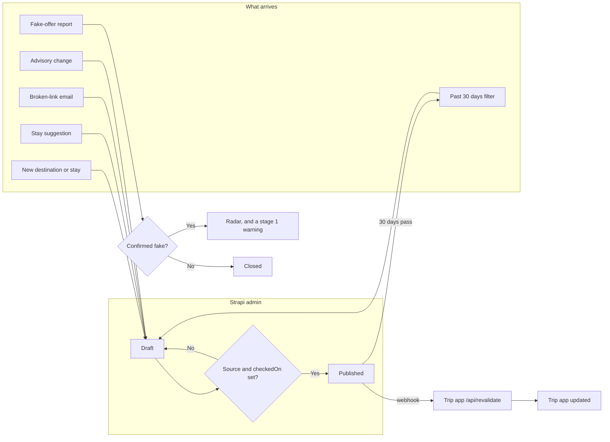

# Trip that pays: the admin side

Plan stage. Nothing is built. This is the admin half of [README.md](README.md). The traveller's page is in
[user-page.md](user-page.md).

---

## 1. Who the admin is and where they work

| | |
|---|---|
| **Who** | You, as owner. Anyone who helps enter destination packs works under you |
| **Where** | The Strapi admin panel already running on EC2. No new admin app in phases 1–2 |
| **What admin controls** | Every fact the traveller sees that isn't from a live API: visa notes, costs, climate, festivals, permits, stays, badges, emergency numbers, step guides, step links, templates, the honesty strip text |
| **What admin never controls** | The traveller's trip. In phases 1–2 it sits in the traveller's browser and admin can't see it. In phase 3 admin sees accounts only to handle deletion and disputes |
| **Roles** | **Super admin (you):** approves new destinations, gives the creator badge, confirms fake offers, publishes showcases. **Editor (helpers):** enters and updates packs as drafts. Check whether Strapi's free edition allows a custom role that can edit but not publish before relying on it; if it doesn't, this split is kept by process |
| **Publishing** | Strapi's Draft & Publish. Nothing reaches the trip app until it's published, and a publish triggers a webhook to the trip app's own `/api/revalidate` so the page updates at once. The trip app is a separate site, so this is a **second webhook** beside the existing app's |

---

## 2. Collections

Every collection has a `checkedOn` date and a "past 30 days" saved filter. Facts also carry a `source` link. Rows
marked *(new here)* weren't listed in README section 14 and are added by this plan.

### Destination facts

| Collection | Fields | Notes |
|---|---|---|
| **destination** | name, slug, country, `inIndia` (yes/no), daily cost range (₹ min and max, sources), tourism-board note, `tourismBoardMediaContact`, creator-friendly stays note, dong rate with source (Vietnam only), status | `inIndia` sets P3 to "Not needed". A destination stays a draft until its visa note (outside India) and emergency numbers are published (section 3) |
| **visa-note** | destination, rule text, official link | AI never writes or rewrites this |
| **climate** | destination, best months, source | Open-Meteo isn't used because its free API is non-commercial |
| **festival** | destination, name, dates, year, source | Entered once a year |
| **permit-note** | destination, filming rules, drone rules, source | |
| **emergency-number** *(new here, from the destination pack)* | destination, number, what it's for, source | Feeds the offline safety card. Never AI-generated |

### Stays

| Collection | Fields | Notes |
|---|---|---|
| **stay** | destination, name, type (homestay, hostel, hero, chain), area, map position (looked up once), safety notes, women-solo review note, WiFi, power backup, locker, laundry, free cancellation, booking link, website, Instagram, **Pehchan-checked** (yes/no, who, date), **Open to creator stays** (yes/no, written OK file, date), status | The creator badge can't be set without the written OK file. Pehchan-checked is never linked to payment |
| **stay-suggestion** *(new here)* | stay name, link, destination, what the traveller said, status (new, checked, rejected) | From "a stay not on our list" in 0b |

### Stage 1 steps

| Collection | Fields | Notes |
|---|---|---|
| **step-guide** | step ID, "how to do it" text, required or optional, rule numbers (pitch target 5, threshold 14 days), shown (yes/no) | E3 stays hidden until its commission rates are sourced |
| **step-link** | step ID, label, URL, destination (optional), kind (official, affiliate network, platform), allowed domains, minimum followers, commission note with source, note on conflicting sources, broken (set by the weekly check), shown (yes/no) | TripGyani stays hidden until rechecked. Barter shows both 2,000 and 2,500 until its pages agree |

### Templates and page text *(new here, from "keep templates current")*

| Collection | Fields | Notes |
|---|---|---|
| **template** | name (shot list, media kit, hotel pitch, tourism-board pitch, consent form, points plan, partner report, guide page), language, body, lawyer-checked date (consent form only) | The consent form can't be published without a lawyer-checked date |
| **trip-page-settings** (single entry) | honesty strip lines, honest timeline text, worked example link, CA-approved date for tax wording, **0a scoring weights** (one per question, with the date last changed and why), AI on/off per stage, AI daily limit | Tax wording stays hidden until the CA date is set. Weights live here so a change is a publish, not a code release |

### Queues

| Collection | Fields | Phase |
|---|---|---|
| **offer-report** | what was offered, stay or brand name, link, how it reached them, date, status (new, confirmed fake, not fake), sent-to-radar date | 1 |
| **ai-flag** | which tool (pitch, caption, shot list, report), the draft text the traveller chose to send, what they said was wrong, date, status (new, fixed in prompt, not a fault) | 3, when AI drafts arrive. Only drafts the traveller sends in; nothing else from their trip |
| **alert** | radar item, destination, what changed, checked by, status | 3 |
| **showcase** | trip summary, film link, ad labels shown, consent confirmed, status | 3 |
| **dispute** *(new here)* | stay, what was agreed, what happened, evidence, outcome, badge removed (yes/no) | 3 |
| **deletion-request** *(new here)* | account, date asked, date done | 3, once accounts exist |

### Money

| Collection | Fields | Phase |
|---|---|---|
| **commission-log** *(new here)* | month, network (Agoda, Travelpayouts, GetYourGuide, Klook), clicks, bookings, amount, screenshot | 1. Typed in monthly from each network's own dashboard, so the figure always has a source |

---

## 3. Adding a destination (the destination pack)

A destination appears in the trip app once its **safety items** are published, sourced and dated: the visa note
(item 1, outside India) and the emergency numbers (item 8). Publish every other item when you find an official source
for it. Until then, leave it empty: the site shows "Not entered yet". Never guess a fact to fill a gap.
**Changed 16 Nov 2026 (owner):** this used to need every item.

| # | Item | Where it comes from |
|---|---|---|
| 1 | Visa note | The official government site |
| 2 | Daily cost range | Admin judgement, with sources |
| 3 | Best months | The national weather service or tourism board. With no official months, leave them empty and say in the note why and what to avoid |
| 4 | Festivals | Official tourism calendar |
| 5 | Permit notes | Official filming and drone rules |
| 6 | Dong rate (Vietnam only) | A named source, monthly. Also confirm the fixed dirham and Nepali rupee rates on the central banks' sites |
| 7 | 10–20 checked stays (none at launch; added after it, task 4.06) | Checked by you against the 6-point check |
| 8 | Emergency numbers | Official sources |
| 9 | Tourism board media contact | The board's own site |
| 10 | Step links for the destination's airlines and hotel chains | Their official sign-up pages |

**How long a pack takes isn't known.** You time the first one; that sets the pace (about one new destination a month
is the plan).

---

## 4. Checking a stay

| Step | What admin does |
|---|---|
| 1 | Look up the map position once and save it. Nominatim allows 1 request a second, so never in bulk |
| 2 | Check recent guest photos against the listing |
| 3 | Read recent reviews from women travelling alone and write the safety note |
| 4 | Confirm WiFi, power backup, locker, laundry and free cancellation with the stay |
| 5 | Add the booking link and check it's labelled |
| 6 | Set **Pehchan-checked** only if all of the above pass |
| 7 | Set **Open to creator stays** only after the stay agrees in writing; upload that message |

---

## 5. Queues admin works through

| Queue | What arrives | What admin does | Where it goes |
|---|---|---|---|
| **Fake offers** | Reports from S1's "Report a fake offer" | Check the stay's official site and phone. Mark confirmed fake or not fake | Confirmed fakes go to the radar and can become a warning in stage 1 |
| **Flagged AI drafts** | "Flag this draft" from the traveller's page | Read it, decide whether the prompt or a rule caused it, fix and rerun the evals, or mark "not a fault" | A prompt change, and a new eval case so it doesn't come back |
| **Stay suggestions** | Stays travellers add in 0b | Run the stay check, or reject | A new `stay` draft |
| **Broken links** | The weekly email, covering step links, stay booking links and the official links in visa, permit and emergency notes | Fix the URL, update `checkedOn`. If the programme or stay is gone, hide it | The page updates on publish |
| **Stale facts** | The "past 30 days" filter | Recheck against the source, update `checkedOn` | The amber warning clears on the page |
| **Advisory changes** | The daily advisory check | Read the change, decide whether a visa or permit note also needs updating | Highlighted automatically on the page |
| **Radar alerts** (phase 3) | Strikes and visa changes | Check each against an official source before publishing | Stage 2 Today view |
| **Showcases** (phase 3) | "Feature my trip" requests | Check it's honest, ads are labelled and consent is shown | Published as a worked example |
| **Disputes** (phase 3) | A stay broke a deal, or a traveller didn't deliver | Review the written terms; remove the creator badge if needed | The stay record |
| **Deletion requests** (phase 3) | From account holders | Delete the account and trips | Logged with the date done |

---

## 6. The monthly routine (one session)

1. Recheck everything in the "past 30 days" filter.
2. Update the dong rate and confirm the fixed rates.
3. Work the fake-offer, stay-suggestion and flagged-AI-draft queues.
4. Check new stays for the next destination.
5. Enter last month's commission from each network's dashboard.
6. Look at the most-skipped steps and fix the guide text or link behind the top one.
7. If AI is on: read five random drafts per AI tool from the eval log (not from travellers' trips), and check the
   month's AI cost against the budget.
8. Confirm last month's Strapi backup exists and opens.
9. Phase 3: showcases, disputes, deletion requests.

Yearly: festivals and climate months for every destination. Quarterly: review the 0a scoring weights in
trip-page-settings, writing down why any weight changed.

---

## 7. What runs on its own

| Job | When | What it does | Admin sees |
|---|---|---|---|
| **Link check** (`/api/cron/check-links`) | Weekly, Vercel Cron | Opens every outbound link: step links, stay booking links, official visa, permit and emergency links. Marks broken ones | An email through Resend listing them |
| **Strapi backup** | Daily, on the EC2 server | Copies the SQLite database file somewhere off the server. What exists today isn't known; check before phase 1 and ask before paying for storage | A failure email |
| **Advisory check** | Daily, Vercel Cron | Compares GOV.UK advice with the last copy | The changed destination highlighted on the page, and an email |
| **Exchange rates** | Daily | Caches Frankfurter rates for 24 hours | Nothing unless it fails |
| **Creator counts** (phase 2) | Weekly | YouTube Data API counts, kept within the 30-day rule | Nothing unless it fails |
| **Cache refresh** | On every publish | A second Strapi webhook calls the trip app's `/api/revalidate` | The change live in the trip app |

---

## 8. Rules the system enforces

- A fact can't be published without a `source` and a `checkedOn` date.
- The creator badge can't be set without the stay's written OK.
- Pehchan-checked is never tied to payment, a listing fee or a sponsorship.
- The consent form can't be published without the lawyer-checked date; tax wording can't show without the CA date.
- A sponsored destination guide (income line 5) is labelled "Sponsored", and the sponsor can't edit its visa or safety
  facts.
- Hidden links (TripGyani, E3) stay hidden until admin sets them to shown.
- AI output never enters a Strapi field. The one exception is a draft a traveller chooses to send with "Flag this
  draft", which lands in `ai-flag` only.
- The public forms (fake-offer report, stay suggestion, flag this draft) are rate-limited per IP address, ask for no
  name, email or phone, and reject links outside the allowed list. The IP address is used for the limit only and
  not stored with the report.

---

## 9. Watching the AI

The app already has `src/lib/ai/checks.ts`, the `AI_ENABLED` flag and the evals with `eval-score.ts`. Admin uses them
like this.

| What | How |
|---|---|
| **Switching on** | AI stays off until the evals for that stage pass. It's switched on per stage (0a reasons, stage 1 pitches and captions, stage 3 report) in trip-page-settings, not all at once |
| **Daily limit** | A cap on AI calls per day and per browser. When it's reached, the page says so and the traveller fills the template by hand |
| **Cost** | Checked monthly against the AI budget you set. Nothing paid starts without your yes |
| **What AI never touches** | Visa rules, prices, emergency numbers, safety verdicts, scores. It never sends anything for the traveller |
| **Faults** | Flagged drafts (section 5) become new eval cases, so a fixed fault is tested every release |
| **Privacy** | Admin never sees a traveller's drafts unless they flag one. The spot check reads the eval log, not real trips |

---

## 10. What admin gets out of it

| | |
|---|---|
| **Income** | Booking commission from phase 1, recorded monthly with sources. Later: creator-stay listings, sponsored guides and the Creator tier |
| **Supply** | Stays that agreed to creator deals, which is the list income line 4 is sold to |
| **Pitch numbers** | Anonymous totals from travellers who opted in: nights booked per destination, creator-stay deals done. These go in pitches to stays and tourism boards. Never a named traveller, and only counted from people who said yes |
| **Signals** | Most-skipped steps, drop-off stage, hotels open to creators per destination |
| **Radar input** | Confirmed fake offers, which feed the radar and, later, the paid radar (Pro) content |
| **Leads** | Travellers who ask about the Creator tier or a sponsored guide come through the existing contact form |
| **Content** | Showcased trips and the worked example for Instagram |

The numbers come from the analytics tool, which hasn't been chosen yet; check what the app already uses first, and
ask before adding anything paid.

---

## 11. Build order for admin

| Phase | What admin gets |
|---|---|
| **Before 1** | Find out what backs up Strapi's SQLite file today and how to restore it |
| **1** | destination, visa-note, climate, festival, permit-note, emergency-number, stay, stay-suggestion, step-guide, step-link, template, trip-page-settings (with scoring weights), offer-report, commission-log. Webhook to `/api/revalidate`. Weekly link check on all links, daily advisory check, daily backup. Rate limits on the public forms. One destination pack |
| **2** | More destination packs. Hindi versions of templates, step guides, honesty strip and the destination facts that travellers read. Creator-count job, records for the Creator tier price test, opt-in anonymous totals for pitches |
| **3** | alert, showcase, dispute, deletion-request, ai-flag and the AI oversight in section 9. A traveller database separate from Strapi, which you choose, and you're asked first if it costs money |

---

## 12. How content moves through admin

