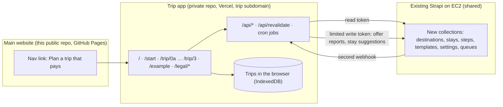
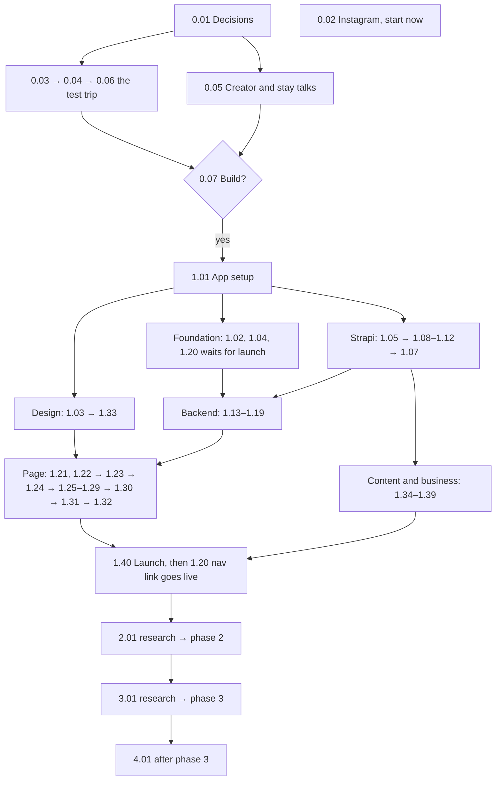

# Trip that pays: tasks

The build plan for the trip app, split into tasks that a developer, designer, PM or admin can each pick up and finish.
The plan itself is in [../README.md](../README.md), [../user-page.md](../user-page.md) and [../admin.md](../admin.md).
Every task links back to the sections it comes from. [COVERAGE.md](COVERAGE.md) shows where each point in the plan is
covered.

Nothing is built yet.

---

## 1. What's being built

The trip app is a **separate website** on its own subdomain, with the main Pehchan website linking to it from its
navigation bar.

| Part | What it is | Task |
|---|---|---|
| **Trip app** | New private repo and new Vercel project. Next.js 16 (App Router), Tailwind 4, daisyUI 5, TypeScript | 1.01 |
| **Address** | Proposed `trip.pehchanthetraveller.com` (decision D2) | 1.02 |
| **Content** | Read from the **existing Strapi on EC2**, in new collections. Admin stays in one place | 1.05, 1.08–1.12 |
| **Code** | Useful parts copied from the existing Next.js app (trip-plan sharing, Resend, `checks.ts` and evals, safety router, offline, `/hi/` approach). Nothing is shared at runtime | 1.04 |
| **Traveller trips** | Saved in the traveller's browser (IndexedDB) in phases 1 and 2. A traveller database comes with accounts in phase 3 | 1.17, 3.02 |
| **Main website (this repo)** | Gets **only a nav link**: desktop nav, phone drawer and footer. No app code, no tokens, no admin content, because this repo is public | 1.20 |

---

## 2. How to read a task

Every task file has the same shape.

| Part | What it tells you |
|---|---|
| **Header table** | Phase, area, who leads, who else is involved, what it depends on, what it unblocks, which plan sections it comes from, and its status |
| **Why it matters** | The reason for the task, in a sentence or two. Read this before cutting scope |
| **The body** | What to build, write or decide, in tables where possible. Anything the plan doesn't settle is marked **not settled** or **not from the plan**, with who decides |
| **Acceptance criteria** | Tick boxes. The task is done when every box is ticked, and not before |

Numbers like `1.23` are task IDs: the first digit is the phase.

### Rules every task follows

- **No invented facts.** Every fact, rate or number shown to a traveller has a source and a checked date. If a source
  isn't found, the item stays hidden until it is.
- **Secrets stay in Vercel.** No token or key goes in any repo, and nothing for the trip app goes in this public repo
  except the nav link.
- **No paid dependency** is added without the owner's yes. The default budget is ₹0 with AI off (D6).
- **Small commits** with descriptive messages.
- **AI never states visa rules, emergency numbers, prices or rates**, and every AI draft is labelled (phase 3).

---

## 3. Roles

| Role | Who | Leads on |
|---|---|---|
| **Owner** | Pehchan's founder | Phase 0, decisions D1–D7, the build decision (0.07), budget, the first destination pack |
| **PM** | To be named | Content, legal and tax reviews, partner accounts, measurement, launch, research tasks |
| **Designer** | To be named | Design system, screens, accessibility, media kit builder |
| **Developer** | Bhavu211 or Rajpal (D5) | The app, its API routes, jobs and the nav link |
| **Strapi owner** | Rajpal | Strapi collections, roles, backups |
| **Admin** | The owner, then helpers as Strapi editors | Destination packs, stay checks, queues, the monthly routine |
| **Outside reviewers** | A lawyer and a CA | Consent and terms; tax wording (1.34) |

## 4. Statuses

| Status | Meaning |
|---|---|
| **To do** | Not started |
| **In progress** | Someone has it; their name goes next to the status |
| **Blocked** | Waiting on a dependency or a decision; say which |
| **In review** | Built or written; waiting for the acceptance criteria to be checked by someone other than the lead |
| **Done** | Every acceptance box ticked |

Change the **Status** row in the task file itself, so the folder is always the single source of truth.

---

## 5. Phases

| Phase | What it proves or delivers | Gate to move on |
|---|---|---|
| **0 · The test trip** | Pehchan's own documentary trip, run through stages 0a to 3 on a Google Sheet and WhatsApp, before any code | 0.07: the result meets the pass mark set before the talks |
| **1 · The trip app goes live** | Both modes, every stage, safety, the worked example, booking links, export and import, one destination pack. Trips saved in the browser | 1.40 launch checklist |
| **2 · Live data and more places** | Live scoring data, partner tracker, media kit builder, Hindi, tours, more destinations, new income lines 4 and 5 | 2.01 research done first |
| **3 · Accounts and AI** | Accounts and sync, connected YouTube and Instagram, AI drafts, partner reports, radar alerts, paid Creator tier | 3.01 research and approvals done first |
| **After 3** | Travelling with a friend | Accounts live |

---

## 6. All tasks

### Phase 0: the test trip

| ID | Task | Lead | Depends on |
|---|---|---|---|
| [0.01](0.01-decisions.md) | Close the decisions that block everything | Owner | — |
| [0.02](0.02-instagram-account.md) | Start Pehchan's Instagram account now | Owner | — |
| [0.03](0.03-run-stage-0a-on-paper.md) | Run stage 0a by hand on 3–5 real places | Owner | 0.01 (D3) |
| [0.04](0.04-check-stays.md) | Check 10–20 stays in the chosen place, and time it | Owner | 0.03 |
| [0.05](0.05-creator-and-stay-talks.md) | Talk to 10 Indian travel creators and 10 stays | Owner | 0.01 (D4), 0.03 |
| [0.06](0.06-take-the-trip.md) | Take the trip and keep the real Trip Balance | Owner | 0.03, 0.04 |
| [0.07](0.07-build-decision.md) | Decide whether to build, against the pass mark | Owner | 0.01 (D4), 0.05, 0.06 |

### Phase 1: foundation

| ID | Task | Lead | Depends on |
|---|---|---|---|
| [1.01](1.01-app-setup.md) | Set up the separate trip app | Developer | 0.01 (D2, D5), 0.07 |
| [1.02](1.02-subdomain-and-seo.md) | Subdomain, HTTPS and search basics | Developer | 0.01 (D2), 1.01 |
| [1.03](1.03-design-system-and-screens.md) | Design system and screen designs | Designer | 0.06, 1.01 |
| [1.04](1.04-port-code-from-existing-app.md) | Copy what's reusable from the existing Next.js app | Developer | 1.01 |
| [1.20](1.20-main-website-nav-link.md) | Link the trip app from the main website's navigation | Developer | 0.01 (D2), 1.02, 1.19 |

### Phase 1: Strapi and content model

| ID | Task | Lead | Depends on |
|---|---|---|---|
| [1.05](1.05-strapi-connection.md) | Connect the trip app to the shared Strapi | Developer | 1.01, 1.02 |
| [1.06](1.06-strapi-backup.md) | Check and set up Strapi backups | Strapi owner | — |
| [1.07](1.07-strapi-roles-and-rules.md) | Strapi roles, publishing and enforced rules | Strapi owner | 1.08–1.12 |
| [1.08](1.08-destination-collections.md) | Destination-fact collections | Strapi owner | 1.05, 1.06 |
| [1.09](1.09-stay-collections.md) | Stay and stay-suggestion collections | Strapi owner | 1.05, 1.08 |
| [1.10](1.10-step-collections-and-seed.md) | Step-guide and step-link collections, with seed content | PM | 1.05, 0.06 |
| [1.11](1.11-template-and-settings.md) | Template and trip-page-settings collections | PM | 1.05, 0.03, 0.06 |
| [1.12](1.12-queue-and-money-collections.md) | Offer-report and commission-log collections | Strapi owner | 1.05 |

### Phase 1: backend and data

| ID | Task | Lead | Depends on |
|---|---|---|---|
| [1.13](1.13-content-api-and-revalidate.md) | Content API routes and cache revalidation | Developer | 1.04, 1.05, 1.08–1.11 |
| [1.14](1.14-live-data.md) | Live data: advisories, country basics and exchange rates | Developer | 1.01, 1.08 |
| [1.15](1.15-scheduled-jobs.md) | Scheduled jobs | Developer | 1.04, 1.05, 1.13, 1.14 |
| [1.16](1.16-public-forms.md) | Public forms and rate limits | Developer | 1.05, 1.09, 1.12 |
| [1.17](1.17-trip-storage-and-export.md) | Trip storage, autosave, export, import and delete | Developer | 1.01 |
| [1.18](1.18-offline.md) | Offline and bad network | Developer | 1.04, 1.17 |
| [1.19](1.19-analytics-and-events.md) | Analytics and events | Developer | 0.01 (D7), 1.01 |

### Phase 1: the traveller's page

| ID | Task | Lead | Depends on |
|---|---|---|---|
| [1.21](1.21-landing-and-first-visit.md) | Landing page and first-visit screens | Designer, then Developer | 1.03, 1.11, 1.13, 1.17, 1.37 |
| [1.22](1.22-app-shell.md) | App shell: Trip Card, Trip Balance, stepper, honesty strip, trip menu | Developer | 1.03, 1.11, 1.13, 1.17 |
| [1.23](1.23-stage-0a.md) | Stage 0a: choose the place, and why | Developer | 0.03, 1.13, 1.14, 1.22 |
| [1.24](1.24-stage-0b.md) | Stage 0b: choose the stays | Developer | 1.09, 1.13, 1.16, 1.22, 1.23, 1.35 |
| [1.25](1.25-stage-1-do-and-safety.md) | Stage 1: the Do checklist and safety items | Developer | 1.04, 1.11, 1.13, 1.16, 1.18, 1.22 |
| [1.26](1.26-step-engine.md) | Step engine: the parts every guided step shares | Developer | 1.03, 1.10, 1.13, 1.17, 1.22 |
| [1.27](1.27-earn-steps.md) | Earn steps: E1, E2 (and E3 hidden) | Developer | 1.10, 1.26 |
| [1.28](1.28-points-steps.md) | Points steps: P1 to P4 | Developer | 1.10, 1.23, 1.26 |
| [1.29](1.29-stay-free-steps.md) | Stay-free steps: S1 to S3 | Developer | 1.10, 1.16, 1.24, 1.26 |
| [1.30](1.30-checkpoint-and-departure.md) | Checkpoint "Ready for the trip?" and the move to stage 2 | Developer | 1.25–1.29 |
| [1.31](1.31-stage-2.md) | Stage 2: during the trip (phone first) | Developer | 1.04, 1.18, 1.22, 1.27–1.30 |
| [1.32](1.32-stage-3.md) | Stage 3: after the trip | Developer | 1.11, 1.22, 1.31 |
| [1.33](1.33-accessibility-and-responsive.md) | Accessibility, phone layout and slow networks | Designer | 1.03 |

### Phase 1: content, business and launch

| ID | Task | Lead | Depends on |
|---|---|---|---|
| [1.34](1.34-legal-and-tax-reviews.md) | Lawyer, CA and rules reviews | PM | 1.11, 1.21, 1.25 |
| [1.35](1.35-affiliate-accounts-and-disclosure.md) | Pehchan's own booking-partner accounts and disclosure | PM | 0.01, 1.34 |
| [1.36](1.36-first-destination-pack.md) | The first destination pack | Admin (owner) | 0.03, 0.04, 1.08–1.11, 1.35 |
| [1.37](1.37-worked-example.md) | The worked example (Pehchan's own trip) | PM | 0.06, 1.32 |
| [1.38](1.38-admin-runbook.md) | Admin runbook | PM | 1.06, 1.07, 1.12, 1.15, 1.16, 1.36 |
| [1.39](1.39-measurement.md) | Measuring how it's working | PM | 0.01 (D7), 1.19, 1.35 |
| [1.40](1.40-launch-checklist.md) | Launch checklist | PM | All of 1.01–1.39 |

### Phase 2

| ID | Task | Lead | Depends on |
|---|---|---|---|
| [2.01](2.01-phase-2-research.md) | Phase 2 research: rules and rates before building | PM | 1.40 |
| [2.02](2.02-youtube-creator-counts.md) | Live scoring data: YouTube creator counts for 0a | Developer | 2.01, 1.15, 1.23 |
| [2.03](2.03-travelpayouts-flight-prices.md) | Live scoring data: flight prices from Travelpayouts | Developer | 2.01, 1.35, 1.23 |
| [2.04](2.04-partner-tracker.md) | Partner tracker | Developer | 1.27, 1.29, 1.31, 1.32 |
| [2.05](2.05-media-kit-builder.md) | Media kit builder | Designer | 1.11, 1.25 |
| [2.06](2.06-hindi.md) | Hindi version | Developer | 1.04, 1.08–1.11 |
| [2.07](2.07-email-reminders.md) | Opt-in email reminders | Developer | 2.04, 1.04 |
| [2.08](2.08-tours.md) | Tours with booking links in 0b and stage 2 | Developer | 2.01, 1.35 |
| [2.09](2.09-e3-insurance-esim-forex.md) | E3: insurance, eSIM and forex commission | PM | 2.01 |
| [2.10](2.10-anonymous-pitch-totals.md) | Opt-in anonymous totals for pitches | Developer | 1.19, 1.32 |
| [2.11](2.11-creator-tier-price-test.md) | Creator tier price test | PM | 1.39 |
| [2.12](2.12-more-destination-packs.md) | More destination packs | Admin | 1.36, 1.38 |
| [2.13](2.13-creator-stay-listings.md) | "Open to creator stays" listings (income line 4) | PM | 1.36, 2.10, 2.12 |
| [2.14](2.14-sponsored-destination-guides.md) | Sponsored destination guides (income line 5) | PM | 1.08, 1.39, 2.10 |

### Phase 3

| ID | Task | Lead | Depends on |
|---|---|---|---|
| [3.01](3.01-phase-3-research.md) | Phase 3 research and approvals | PM | Phase 2 done |
| [3.02](3.02-traveller-database.md) | Choose and set up the traveller database | Developer | 3.01 |
| [3.03](3.03-accounts-and-sync.md) | Accounts and sync | Developer | 3.02 |
| [3.04](3.04-deletion-requests.md) | Deletion requests | Developer | 3.03 |
| [3.05](3.05-ai-foundations.md) | AI foundations: one draft route, checks, evals and limits | Developer | 1.04, 1.11, 3.01 |
| [3.06](3.06-ai-features-by-stage.md) | AI features by stage | Developer | 3.05 |
| [3.07](3.07-connected-youtube-instagram.md) | Connected YouTube Analytics and Instagram numbers | Developer | 3.01, 3.03, 2.05 |
| [3.08](3.08-automatic-partner-reports.md) | Automatic partner reports | Developer | 3.07, 2.04, 1.32 |
| [3.09](3.09-checked-radar-alerts.md) | Checked radar alerts in stage 2 | Developer | The radar (docs/22, docs/23), 1.31 |
| [3.10](3.10-showcase-and-disputes.md) | "Feature my trip" showcases and disputes | PM | 3.03, 1.32 |
| [3.11](3.11-paid-creator-tier.md) | Paid Creator tier (income line 3) | Developer | 2.11, 3.03, 3.05, 3.07, 3.08 |
| [3.12](3.12-pre-sell-own-film.md) | Pre-selling Pehchan's own film (income line 6) | PM | 3.01 |

### After phase 3

| ID | Task | Lead | Depends on |
|---|---|---|---|
| [4.01](4.01-travelling-with-a-friend.md) | Travelling with a friend | Developer | 3.03 |

---

## 7. The order of work

Phase 0 runs before any code. In phase 1, three tracks run side by side once the app exists, and meet at the stage
pages.

The critical path in phase 1 is **1.01 → 1.05 → 1.08–1.11 → 1.13 → 1.22 → 1.23 → 1.24 → 1.26 → 1.27–1.29 → 1.30 →
1.31 → 1.32 → 1.40**. The first destination pack (1.36) and the legal reviews (1.34) take calendar time outside the
code, so start them as soon as their dependencies allow.

---

## 8. Decisions

The open decisions D1–D7 are in [0.01](0.01-decisions.md), with their defaults. Record each answer there with a date
and who decided.

**Decided on 14 Nov 2026:** the trip app is a separate website on its own subdomain, with its own private repo and
Vercel project, reading content from the existing Strapi on EC2. Code from the existing Next.js app is copied in, not
shared. The main website links to it from the nav bar (1.20).

**Who builds it (D5):** _not yet decided._ Name and hours per week go here once decided.

### The build decision (0.07)

| | |
|---|---|
| **Pass mark (D4), set before the talks** | _not yet set_ |
| **Date set** | |
| **Result** | |
| **Decision (build / change / stop)** | |
| **Date and who decided** | |

---

## 9. Model guidance

From the plan (README §16) and the owner's working rules:

| Work | Model |
|---|---|
| Planning, architecture, tricky debugging | Opus |
| Building and standard edits | Sonnet |
| Entering destination packs and other bulk, repetitive edits | Haiku |

---

## 10. Effect on other plans

| Plan | Effect |
|---|---|
| **Problem Lab (docs/24)** | Its customer becomes the *Indian traveller planning a trip that becomes content, women first*. "Does it hurt our traveller?" becomes "does it hurt a traveller at any stage, 0a to 3?" "Is there a money path?" becomes "does solving it feed one of the six income lines?" Solved problems become stage content: a fake-collaboration warning, for example, goes into stage 1 (1.25). No task here changes the Problem Lab files; that plan's owner updates them |
| **Radar plans (docs/22, docs/23)** | Background for now. Their job here is checked alerts in stage 2 (3.09) and feeding problems to the Lab. Raw radar data never goes in this public repo |
| **This static repo** | Gets only the nav link (1.20), in the desktop nav, the phone drawer and the footer, switched on at launch |
| **The existing Next.js app** | Unchanged. Code is copied out of it (1.04). Adding the same nav link there is optional and decided separately |
| **The shared Strapi** | Gets new collections (1.08–1.12), new roles (1.07), a backup check (1.06) and a second webhook pointing at the trip app's `/api/revalidate` (1.13). Existing collections are not changed |
