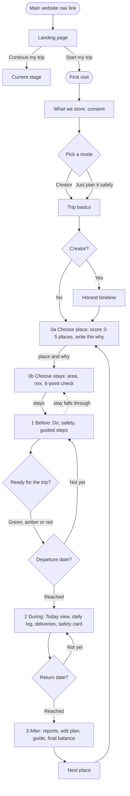

# Trip that pays: the traveller's page (the trip app)

Plan stage. Nothing is built. This is the traveller-facing half of [README.md](README.md). The admin half is in
[admin.md](admin.md).

---

## 1. Who uses it and where

| | |
|---|---|
| **Address** | A separate app on its own subdomain, proposed `trip.pehchanthetraveller.com` (decided 14 Nov 2026). Stage pages are `/trip/0a` to `/trip/3`. The main website links to it from its nav bar and footer; it gets no other new page |
| **Who** | Indian travellers, women first, travelling solo, within India or to Dubai/UAE, Vietnam, Thailand, Malaysia or Nepal |
| **Login** | None in phases 1–2. The trip is saved in the traveller's browser. Accounts with an email sign-in link come in phase 3 |
| **Cost to the traveller** | Free. A paid Creator tier comes in phase 3, at a price tested in phase 2 |
| **Devices** | Phone first for stage 2. Wider comparison tables on a laptop for stages 0a to 1 |
| **Language** | English at launch. Hindi in phase 2, using the existing `/hi/` setup |

---

## 2. First visit

Most visitors arrive from the main website's nav, so the app's address opens on a **landing page** first: what the
page does, the two modes, the worked example (once Pehchan's own trip is done), and a "Start my trip" button. If a trip is already saved in this
browser, it also shows "Continue my trip", which opens the current stage. Details are in
[tasks/1.21](tasks/1.21-landing-and-first-visit.md).

After "Start my trip", the traveller sees four short screens, then lands on stage 0a.

| # | Screen | What it holds | Why |
|---|---|---|---|
| 1 | **What we store** | What's saved, where (this browser only), and that card numbers, full membership numbers, passport details and passwords are never asked for. "Continue" and "Read more" | Consent at the start, as the Digital Personal Data Protection Act 2023 expects. A lawyer checks the wording once |
| 2 | **Pick a mode** | **Creator:** Do, Earn, Points and Stay free at every stage. **Just plan it safely:** the planner, safety layer and checked stays only. Can be switched later | One page serves both the creator and Pehchan's safety-first traveller |
| 3 | **Your trip basics** | Home city, budget (₹), travel month, passport country, trip length | These fill the facts in 0a and the checks in stage 1 (for example, P4's "reachable" test) |
| 4 | **The honest timeline** (Creator only) | Trip 1: you pay most of it. Trips 2–3: some free stays and paid reels. After that: trips mostly pay for themselves. Labelled "a typical pattern, not a sourced figure" | Sets expectations before anyone feels misled |

A **worked example** link (your own documentary trip) sits on every one of these screens **once the trip is done**.
The pages launch before it (changed 16 Nov 2026), so until then the link is hidden and nothing claims proof.

---

## 3. What's on screen all the time

### The Trip Card (top of every stage)

| Part | What it shows | Behaviour |
|---|---|---|
| Destination, dates, "why" line | Filled from 0a | Edit takes the traveller back to 0a |
| **Trip Balance** | Spent · earned · saved with points · free nights · **net** | Agreed money and agreed free nights show in grey as "expected". Only money received and nights used count in the net. A negative net is shown plainly |

**Where each Trip Balance figure comes from.** The traveller enters every figure, or it's taken from their own
outputs. The page never estimates one.

| Figure | Filled from |
|---|---|
| **Spent** | The money diary: the ₹ actually paid, from the card or forex statement, not the local price converted |
| **Earned** | Money received from E1 pre-sales and sponsors, paid deals in the partner tracker, and booking commission the traveller copies from their own network dashboard. Agreed but unpaid shows in grey |
| **Saved with points** | Each redemption: points used, plus the ₹ price they'd otherwise have paid, with a screenshot of that price |
| **Free nights** | Barter nights actually used (from S1, and on-the-spot deals in stage 2). Valued at the room's normal price if the traveller enters it, otherwise shown as a count |
| **Net** | Earned + saved with points + value of free nights − spent |
| Current stage and next step | "Stage 1 · Next: send 3 more pitches" | Tapping it opens that step |
| Mode | Creator or Just plan it safely | Switching hides or shows Earn, Points and Stay free; nothing typed is lost |
| To-dos | Open items carried over from a stage that moved on by date | Each links to its step |

### The stage stepper

`0a Choose place → 0b Choose stays → 1 Before → 2 During → 3 After`

- One stage panel shows at a time.
- Every panel uses the same blocks: **Do · Earn · Points · Stay free**, with that stage's **safety items** inside it.
- In Just plan it safely mode, only Do and safety show.
- Earlier stages stay open for editing. If a stay falls through in stage 1, the traveller goes back to 0b and nothing
  is lost.

### The honesty strip

Always visible, one line each, with a "why" link:
- Label every partner post. Free stays, meals and barter count as a paid relationship under ASCI rules.
- Free stays can be taxable, so check with a CA. (A CA approves this wording before launch.)
- Get consent before filming people.

### Trip menu

| Action | What it does |
|---|---|
| **Export my trip** | A file with every output and evidence file, plus a PDF |
| **Import** | Brings a trip back from that file |
| **Share with a trusted contact** | Uses the existing trip-plan share |
| **Save offline** | Uses the existing offline feature. Needed for stage 2 |
| **Delete my trip** | Removes it from the browser after a confirm step |
| **Next place** | Shown after stage 3. Starts a new trip at 0a with this trip's numbers carried into the media kit |

---

## 4. Stage 0a: Choose the place, and why

| | |
|---|---|
| **Already on the page** | The destination list, each with: best months (admin, sourced), UK government travel advice, currency and languages, exchange rate to ₹ with its date, festivals, visa note with "last checked" date and official link, daily cost range, permit note. Example "why" lines |
| **Traveller enters** | 3–5 candidate places, a story angle, scores of 0–3 for the questions only they can answer, final pick, the "why" line |
| **The scoring table** | One row per place, one column per question below, a total, and a bonus point for places already visited. Data-filled cells are marked "from data" with a date |

| # | Question | Phase 1 | Phase 2 |
|---|---|---|---|
| 1 | Is there a story only I can tell? | Traveller | Traveller (AI angle suggestions in phase 3) |
| 2 | Do Indians want to go there? | Traveller checks Instagram and YouTube | Recent video counts and views from the YouTube Data API |
| 3 | How crowded is it with creators? | Traveller | YouTube Data API counts, refreshed weekly |
| 4 | Can my audience afford it? | Admin's daily cost range | Plus flight prices from Travelpayouts |
| 5 | How easy is the visa? | Admin visa note. **AI never states visa rules** | Same |
| 6 | Can it earn? | Admin note on bookable stays, creator-friendly stays and the tourism board | Plus booking-link coverage |
| 7 | Can I film there? | Admin permit note plus the traveller's comfort | Same |
| 8 | Is the timing right? | Admin festivals and climate months | Same |

- **The score comes from the formula and the data, never from AI.** From phase 3, an "Explain" button gives a
  labelled "AI explanation" of why the top place fits.
- **Safety:** the advisory sits beside every place. A place with a serious advisory is flagged on its card, not hidden.
- **Stale facts:** anything admin last checked over 30 days ago shows amber: "Last checked over 30 days ago, confirm on
  the official site."
- **Done when:** one place is picked and the "why" line is written. The "why" goes into the media kit and every pitch;
  the place and dates go to 0b.

---

## 5. Stage 0b: Choose the stays

| | |
|---|---|
| **Already on the page** | Checked stays for the destination (none at launch: until the first are checked, 0b says "No checked stays are published for this place yet" and the traveller adds their own): area, women-safety notes, WiFi, power backup, locker, laundry, free cancellation, booking link, and two badges (below). The stay-mix guide. The 6-point check |
| **Traveller enters** | Dates, budget per night, stay style, a shortlist, answers to the 6-point check for each, and any stay not on Pehchan's list (sent to admin to review) |
| **Choose the area first** | Areas are listed before properties, each with a short note on its character (old town, market street, waterfront) |

**The stay mix, shown as four slots to fill:** base homestay or guesthouse (most nights), hostel (1–2 nights), one hero
stay (1 night), chain hotel paid with points (nights no partner covers).

**The 6-point check, one tick each per shortlisted stay:** safe · close to your shots · real · practical · flexible ·
earns.

**Badges, which never mix:**

| Badge | What the traveller is told |
|---|---|
| **Pehchan-checked** | Admin has verified it. Never paid for |
| **Open to creator stays** | The stay agreed in writing to consider content-for-stay deals. Labelled commercial. Listed first for barter pitches |

- **Tours for shoot days (phase 2):** tours near the chosen area with booking links from GetYourGuide, Klook or Viator,
  each labelled as an affiliate link. Commission figures for these aren't shown until the conflicting sources agree.
- **Map:** a "Open in map app" link per stay. No embedded map at launch.
- **AI (phase 3):** a labelled "AI summary of reviews" of what women travelling alone say about the area, and a flag on
  any shortlisted stay that fails the 6-point check.
- **Safety:** first barter stays only where recent reviews from women travelling alone exist; meet hosts in public
  first; check the listing matches the map location.
- **Done when:** base and hero stays are chosen and pass the 6-point check. Stays go into the partner tracker and S1's
  stay picker.

---

## 6. Stage 1: Before (4–8 weeks out)

### Do (checklist, every mode)

| Item | What the page gives |
|---|---|
| Story and shot list | A template. AI draft from the story angle in phase 3 |
| Filming and drone rules | The admin permit note for the destination |
| Music | A reminder that the film needs music it's licensed to use: the platform's own library, a paid licence, or original music. Background music recorded at a shoot location can trigger a copyright claim |
| Filming on private property | Ask the owner first (stays, cafés, shops, temples). Get a "yes" in writing for anything shown in a paid post |
| Media kit | Phase 1: a template. Phase 2: the media kit builder. Follower numbers are typed in with a screenshot until phase 3 connects accounts |
| Consent form | English and Hindi, lawyer-checked. **Children:** a parent's or guardian's consent, and no face close-ups without it. **Women filmed in public:** ask before filming, and blur faces of anyone who didn't agree |
| Insurance that covers camera gear | A reminder and what to look for |
| "I'm going to X, what should I film?" post | A prompt |

### Safety (every mode)

- **Fake-offer checklist:** verify through the hotel's official website and phone, never pay to collaborate, share ID
  only at check-in. A "Report a fake offer" button.
- Share the itinerary with one trusted contact.
- Prepare the emergency card now and save it offline.

### Guided steps (Creator mode)

Each step is a card with: **How to do it · Do it here (links, with "checked on" dates and affiliate labels) · Your
output (autosaved) · Counts as done when · Feeds.** Statuses: Not started · In progress · Done · Skipped (reason
required) · Not needed (automatic).

| Step | Required? | Traveller fills in | Counts as done when | Feeds |
|---|---|---|---|---|
| **E1** Pre-sell the story | Optional | Route, offer text, price ₹, offer link, sponsors pitched, amount agreed, amount received | Route, offer link and one dated pitch or launch | Trip Balance (expected, then earned), partner tracker |
| **E2** Booking links and post | Required | Programmes and status, tracking links, post URL or date, label tick | One approved programme, one valid link on its domain, post before departure, label ticked | Stage 2 captions, stage 3 guide |
| **E3** Insurance, eSIM, forex commission | — | Not shown until rates are sourced | — | — |
| **P1** Join programmes before booking | Required | Programme, airline or hotel, date joined, last 4 digits (optional), first booking date | One airline and one hotel, each joined before first booking. Warns if not | P2 |
| **P2** One main programme of each kind | Required | Main airline, main hotel chain, why, points expiry rule with source | Both chosen, each rule sourced | Stage 2 "log this flight", stage 3 redemption tips |
| **P3** How you'll pay abroad | Required abroad, Not needed for India | Method, markup %, ATM fee, reload fee, leftover rule, source. No card number field | One method with markup % and source | Money diary default |
| **P4** Card sign-up bonus | Optional | Card, bonus, spend needed, deadline, fee, source. Shows "reachable" or "not reachable" against the 0a budget | Decision and source, or skipped | — |
| **S1** Barter pitches | Required | One row per pitch: stay, channel, sent, offer, follow-up, reply, written terms, checklist tick | Target pitches sent (default 5) and every agreed deal has terms and a passed checklist. No agreements still counts | Partner tracker, expected free nights, stage 2 deliveries |
| **S2** Barter platforms | Optional | Platform, eligible (automatic from follower number), applied, status | Eligibility checked, or skipped | — |
| **S3** Tourism board pitch | Optional | Board, contact, sent, story line (filled from 0a), reply, outcome | Sent, or skipped with a reason | Partner tracker |

AI drafts pitches only (phase 3), labelled "AI draft, edit before sending". It never fills an output, amount or
status, and never sends anything. Every AI draft has a **"Flag this draft"** link; it sends only that draft and the
traveller's note to admin, nothing else from the trip.

### The partner tracker (phase 2)

One row per partner moving **pitched → agreed → delivered → reported**, with deal type (barter or paid), what's owed and
by when, and the ad label to use. Sponsor rows from E1 and agreed rows from S1 and S3 appear here automatically.

### Checkpoint: "Ready for the trip?"

One screen, one row per Do item, safety item and guided step, each with status, what's missing and "Go to step".

| Colour | When |
|---|---|
| **Red** | An agreed barter deal has no written terms, or departure is 14 days away or less and a required step isn't started |
| **Green** | Every required step is Done or Not needed, and every optional step is Done or Skipped with a reason |
| **Amber** | Anything else |

It never blocks. On the departure date the stage moves to 2, and open required steps become Trip Card to-dos and stage
2 daily items. In Just plan it safely mode it covers only Do and safety items.

---

## 7. Stage 2: During the trip (phone first)

The stage opens on a **Today** view.

| Section | What it holds |
|---|---|
| **Deliveries due today** | From the partner tracker: "Hotel X reel due tomorrow" |
| **Daily log** | Footage done · posts made (with an ad-label tick for partner posts) · money spent (local amount **and** the ₹ actually paid, by category) · money received (paid reels, sponsors) · points earned (flight or stay, programme) · points used and the ₹ price saved · free nights used, and from which deal · deliveries done. Each of these updates the Trip Balance |
| **Voice input** | The browser's built-in speech recognition. Typing always works too. From phase 3, AI turns "spent 400 baht on dinner, filmed the night market" into log entries |
| **Safety card** | Checked emergency numbers with source and date. Works offline. Never AI-generated |
| **Check-in nudge** | A reminder to message the trusted contact |
| **"Post after you've left"** | A reminder beside every post: no location tags or Stories from where you're staying until you've checked out |
| **Quick consent form** | Signed on the phone. Kept on the traveller's device only |
| **Booking links** | For tours (GetYourGuide, Klook, Viator from phase 2), stays and SIM cards used today, each labelled as an affiliate link |
| **Carried-over to-dos** | Open stage 1 items, for example "Terms for Stay X still not in writing" |
| **Checked alerts** (phase 3) | Strikes and visa changes from the radar, shown only after a person checks them |

**Earn, Points and Stay free blocks** (Creator mode): paid reels with the sourced rate range, booking links, stock
footage rule (no identifiable people without releases); put every payment on the card, book direct when it pays more,
log every flight; content-for-stay on the spot, with the warning that working for a stay on a tourist visa can break
visa rules.

**AI (phase 3):** daily caption drafts from the log, with the ad label added automatically for partner posts, and a
"Flag this draft" link on each.

**Bad network:** saves on the device first, loads only this stage's data, and runs AI only when tapped.

**Moves on:** automatically on the return date.

---

## 8. Stage 3: After the trip

| Section | What it holds |
|---|---|
| **Partner reports** | One per partner, filled from the traveller's numbers (typed in phases 1–2, connected accounts in phase 3): views, reach, clicks, screenshots. AI draft in phase 3, from real numbers only |
| **Edit plan** | Long version plus 10–20 short clips. AI draft from the log in phase 3 |
| **"How to do this trip" guide** | Costs, stays and mistakes, drafted from the money diary and stays, with the traveller's booking links |
| **Media kit update** | New numbers go into the media kit for the next trip |
| **Festivals and platforms** | A checklist for submitting the film |
| **Tax and records** | What to give a CA: free stays received, paid deals, money received |
| **Feedback** | On each stay and partner. Goes to admin |
| **"Feature my trip"** | Optional. Sends the trip to admin for showcase review (phase 3) |
| **Final Trip Balance** | Closes with the real net figure |
| **Next place** | Starts a new trip at 0a |

**Earn, Points and Stay free** (Creator mode): YouTube Partner Programme route with its source, paid repeat deals,
digital products, licensing, workshops; redeem points for the next flight; pitch bigger hotels with real results.

**Done when:** film out, partner reports sent, guide live.

---

## 9. How it behaves

| Topic | Behaviour |
|---|---|
| **Saving** | Every change saves at once; there's no save button. Phases 1–2: IndexedDB in the browser, including screenshots. Phase 3: the traveller's account |
| **Clearing browser data** | A warning before it's cleared, and a prompt to export |
| **Never asked for** | Card numbers, full membership numbers, passport details, programme passwords |
| **Stale facts** | Every fact shows its source and date. Admin facts over 30 days old show amber |
| **Live data** | Exchange rates show "Rate from [date]". Flight prices (phase 2) show "Prices from [time], may have changed". A changed advisory is highlighted with its date |
| **Partner sites** | Open in a new tab. Pehchan doesn't call partner APIs in stage 1, so approval and links are what the traveller reports |
| **AI** | Runs only on a tap, has a daily limit per traveller, and is always labelled. Never used for visa rules, prices, emergency numbers, safety verdicts or scores. When the limit is reached the page says so and the template still works by hand. "Flag this draft" sends one draft to admin, by choice |
| **Public forms** | Fake-offer reports, stay suggestions and flagged drafts ask for no name, email or phone, and are rate-limited so they can't be flooded |
| **Pitch numbers (phase 2)** | An opt-in tick: "Count my trip, without my name, in Pehchan's totals." Used only as anonymous totals in pitches to stays and tourism boards. Off by default |
| **Reminders** | On the page for everyone. Email reminders through Resend in phase 2, only for travellers who give their email and opt in |
| **Accessibility** | Large tap targets, strong contrast, every feature usable with a keyboard, a label on every input |
| **Empty states** | Each block says what goes there and links to the template or example |

### Actions tracked, with no personal data

`trip_started` · `stage_completed` · `mode` · `affiliate_click` · `ai_draft` · `deal_logged` · `trip_exported` ·
`trip_closed` · `step_completed` · `step_skipped` · `checkpoint_status` · `ai_draft_flagged` · `pitch_totals_opt_in`

---

## 10. What the traveller gets

| Need | How the page meets it |
|---|---|
| Choosing a place that can earn | A scored comparison with dated facts, not a guess |
| Staying cheaply and safely | Checked stays, a 6-point check, and creator-open stays listed first |
| Knowing what to do before leaving | Guided steps with links and a checkpoint, never a blocker |
| Not being scammed | The fake-offer checklist and report button |
| Seeing whether the trip pays | The Trip Balance, honest about losses |
| Keeping control of their data | Saved on their device, export and delete at any time |

---

## 11. Build order for the traveller's page

| Phase | What the traveller gets |
|---|---|
| **1** | Stepper, Trip Card, both modes, first-visit screens, every stage's Do and safety checklists, stage 1 guided steps and checkpoint, honesty strip, booking links, export, import, delete. One destination, picked by AI and published by admin, with no checked stays at first. The worked example comes later, after Pehchan's own trip Data: GOV.UK, REST Countries, Frankfurter plus fixed rates, Strapi |
| **2** | Live scoring data (YouTube, Travelpayouts), partner tracker, media kit builder, Hindi, opt-in email reminders, a price test for the Creator tier, tours with booking links in 0b and stage 2, the opt-in for anonymous pitch totals, more destinations |
| **3** | Accounts and sync, connected YouTube and Instagram numbers, automatic partner reports, AI drafts with "Flag this draft", checked radar alerts, showcase, the paid Creator tier |
| **After 3** | **Travelling with a friend:** one shared trip both people edit, with the Trip Balance split between them. It needs accounts, so it can't come earlier |
| **Last** | **The worked example:** Pehchan's own trip with its real Trip Balance, linked from every first-visit screen |

---

## 12. The traveller's journey

